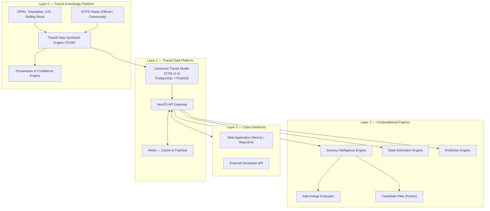
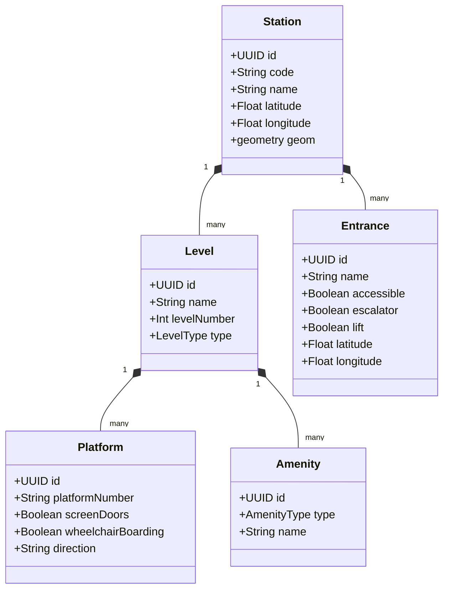

# TransitOS — System Architecture Reference

This document describes the computational architecture, data model, graph formulation, and spatial engineering decisions underpinning the TransitOS platform. It is intended for transport engineers, software engineers, and feasibility analysts working with or contributing to the system.

> **Architecture revision 2026-08**: Four-layer platform model with Layer 0 (Transit Knowledge Platform) added. See [GTFS_SYNTHESIS.md](./GTFS_SYNTHESIS.md) for the Transit Data Synthesis Engine specification.

---

## Table of Contents

1. [System Overview](#1-system-overview)
2. [Layer 0 — Transit Knowledge Platform](#2-layer-0--transit-knowledge-platform)
3. [Layer 1 — Canonical Transit Model (CTM)](#3-layer-1--canonical-transit-model-ctm)
4. [Layer 2 — Computational Engines](#4-layer-2--computational-engines)
5. [Journey Graph Formulation](#5-journey-graph-formulation)
6. [Generalized Cost Scoring](#6-generalized-cost-scoring)
7. [Interchange Friction Model](#7-interchange-friction-model)
8. [Dynamic Feeder Catchment](#8-dynamic-feeder-catchment)
9. [Pareto Dominance and Candidate Filtering](#9-pareto-dominance-and-candidate-filtering)
10. [Spatial Database Design](#10-spatial-database-design)
11. [GeoJSON Architecture](#11-geojson-architecture)
12. [Cache Strategy](#12-cache-strategy)
13. [Realtime Data Levels](#13-realtime-data-levels)
14. [Station Digital Twin Model](#14-station-digital-twin-model)
15. [Technology Stack](#15-technology-stack)

---

## 1. System Overview

TransitOS is structured as a four-layer computational platform. Each layer has a strict ownership boundary; higher layers consume only the APIs of layers below.



**The core design principle**: TransitOS computes. External AI communicates. Routing, generalized cost scoring, interchange friction, and catchment analysis run on deterministic, testable backend engines. AI providers (voice, vision, NLU) sit outside the data dependency chain as interface translation layers only.

---

## 2. Layer 0 — Transit Knowledge Platform

Most transit analysis tools are **consumers** of GTFS. TransitOS is a **producer** of GTFS. This is the architectural distinction that enables coverage of networks where operators have not published standards-compliant feeds.

The Transit Data Synthesis Engine (TDSE) ingests documents classified into ten categories (A–I + X) and synthesizes them into a standards-compliant GTFS schedule and CTM records. Every generated value carries a provenance record and a confidence score.

```
Document Categories:
  A — Network Topology      (DPRs, alignment drawings, route maps)
  B — Station Infrastructure (platform plans, entrance maps, accessibility audits)
  C — Operations            (timetables, headway tables, first/last train schedules)
  D — Rolling Stock         (train specs, manufacturer manuals, type approval docs)
  E — Signalling            (CBTC manuals, block diagrams, speed restrictions)
  F — GIS & Spatial         (shapefiles, OSM exports, GPS surveys)
  G — Commercial            (fare charts, amenity directories, parking info)
  H — Historical Operations (archived timetables, delay reports, community data)
  I — Live Observations     (GTFS-RT, operator APIs, GPS traces, crowdsource)
  X — TransitOS Synthesized (generated GTFS, CTM records, ETA predictions — IP)
```

See [GTFS_SYNTHESIS.md](./GTFS_SYNTHESIS.md) for the complete synthesis pipeline specification.

---

## 3. Layer 1 — Canonical Transit Model (CTM)

The CTM is the normalized relational representation of all transit network data. It is the single source of truth for routing, spatial queries, and corridor analysis.

```
System
  └── Agency
  └── Line  (route)
        └── StationSequence  (ordered stop list with inter-station distances & travel times)
        └── Trip             (individual scheduled vehicle journey)
              └── StopTime   (scheduled arrival/departure per stop)
  └── Station
        └── Level            (concourse, platform, street)
        └── Platform         (boarding berth, direction, screen doors)
        └── Entrance         (gate position, accessibility, lift/escalator)
        └── Amenity          (ATM, ticketing, restroom, etc.)

Spatial: every Station and Entrance carries a PostGIS geometry(Point, 4326)
         indexed with a GIST spatial index for geodesic radius queries.
```

### Data Governance

- **UUID primary keys** on all entities. No integer sequences.
- **Soft deletion only** — `isActive` flag + nullable `deletedAt`. Records are never physically removed.
- **Audit timestamps** — `createdAt`, `updatedAt` (timestamptz) on every table.
- **Inter-station travel times** — populated from GTFS `stop_times.txt` (source of truth) or `StationSequence.travelTimeFromPrevious` (TDSE-synthesized fallback).
- **CTM v1.0 schema frozen** — no breaking changes without a migration and version bump.

---

## 4. Layer 2 — Computational Engines

The computational layer owns the analytical work. Each engine is a NestJS injectable service with a stable interface; no engine calls another engine's internal implementation directly.

| Engine | Service File | Responsibility |
|:---|:---|:---|
| **GraphBuilderService** | `graph/graph-builder.service.ts` | Constructs the in-memory directed multigraph G=(V,E) from CTM data |
| **RoutingService** | `routing/routing.service.ts` | Yen's K-Shortest Paths over modified Dijkstra; returns K candidate routes |
| **ScoringService** | `scoring/scoring.service.ts` | Generalized cost computation per candidate |
| **InterchangeEvaluatorService** | `interchange-evaluator.service.ts` | Built-environment friction model for transfer nodes |
| **CandidateFilterService** | `candidate-filter.service.ts` | Pareto dominance pruning with same-destination awareness |
| **LocalityRoutingService** | `locality-routing.service.ts` | Feeder catchment computation; maps localities to candidate deboarding stations |

---

## 5. Journey Graph Formulation

The transit network is modeled as a directed multigraph:

$$G = (V, E)$$

where:
- $V$ = all CTM stations
- $E$ = typed directed edges:
  - `TRANSIT` — in-vehicle movement from station $u$ to adjacent station $v$ on line $l$; weight = scheduled travel time from `stop_times.txt`
  - `WALK` — pedestrian transfer between stations within interchange radius; weight = geodesic distance ÷ 1.2 m/s
  - `TRANSFER` — logical line-change edge at the same physical station; weight = interchange friction penalty (see §7)

### Yen's K-Shortest Paths

Rather than returning only the shortest path by one metric, the engine generates up to K=5 loopless candidate paths using Yen's algorithm over modified Dijkstra. Candidates differ in transfer count, line used, and deboarding station — providing planners with a Pareto frontier of options rather than a single answer.

**Feasibility pre-filter** (before scoring):
- Rejects paths with loops (same station visited twice)
- Rejects paths with total duration > practical threshold
- Rejects paths with transfer count > 6
- Rejects paths where feeder distance to destination significantly exceeds direct walking alternative

---

## 6. Generalized Cost Scoring

Each candidate path is scored using a generalized cost function. The score is used for Pareto dominance comparison and final ranking.

$$\text{RankScore} = w_t \cdot T_{\text{duration}} + P_{\text{transfer}} \cdot N_{\text{transfers}} + w_w \cdot T_{\text{walking}} + C_{\text{friction}}$$

| Parameter | Default Value | Interpretation |
|:---|:---|:---|
| $w_t$ — travel time weight | 1.0 | Base weight for in-vehicle time (seconds) |
| $w_w$ — walking weight | 0.8 | Walking time is penalized at 0.8× (perceived as less onerous than waiting) |
| $P_{\text{transfer}}$ — transfer penalty | 120 s equivalent | Added per interchange to reflect disutility of transferring |
| $C_{\text{friction}}$ — interchange friction | 0–600+ s | Physical barrier and built-environment cost at specific interchange nodes |

Default weights are defined in `scoring.service.ts` as `DEFAULT_WEIGHTS`. They can be overridden per-query via the API to run sensitivity analysis — e.g., testing how a higher transfer penalty shifts route preference toward longer direct services.

### Sensitivity to Parameter Changes

This is one of the core answers to the question *"What changes when we alter a corridor, station location or operating assumption?"*

| Changed Input | Effect on Outputs |
|:---|:---|
| Increase `transferPenalty` | Paths with fewer interchanges rise in rank; multi-transfer options drop |
| Increase `walkingWeight` | Routes with longer feeder walks become less competitive |
| Remove a station from graph | All paths through that station are eliminated; alternative paths emerge |
| Change `travelTimeFromPrevious` | Section time change propagates to all paths through that section |
| Add a new interchange walk edge | Previously disconnected lines become reachable without a vehicle transfer |
| Shift station coordinates | Feeder catchment radii change; different localities snap to different stations |

---

## 7. Interchange Friction Model

Standard transfer penalty (§6) is a flat constant. The interchange friction model adds a **built-environment cost** $C_{\text{friction}}$ that reflects the physical characteristics of a specific interchange node. This is implemented in `interchange-evaluator.service.ts`.

### Friction Components

| Component | Penalty | Trigger |
|:---|:---|:---|
| Vertical level change | +10 s per metre Δz | Stations on different levels (subway ↔ elevated) |
| AFC turnstile re-tap | +60 s | Unpaid-area transfer requiring re-entry through fare gate |
| Security rescreening | +300 s | Airport-adjacent or security-controlled interchange |
| Outdoor street exposure | +600 s | Transfer requiring exit to street (luggage / weather penalty) |

### Friction Levels

The evaluator maps total $C_{\text{friction}}$ to a discrete `frictionLevel` label:

| Level | Total Penalty | Example |
|:---|:---|:---|
| `MINIMAL` | 0–60 s | Same-platform cross-platform interchange |
| `LOW` | 60–180 s | Paid-area concourse transfer, short walk |
| `MODERATE` | 180–360 s | Unpaid-area transfer, level change |
| `HIGH` | 360–600 s | Street-level transfer, outdoor exposure |
| `CRITICAL` | >600 s | Security rescreening + street + level change |

The `frictionLevel` field is surfaced in the API response, allowing corridor analysts to flag which interchange nodes create the most passenger deterrence.

---

## 8. Dynamic Feeder Catchment

When a locality (named residential or commercial area) is the origin or destination of a journey query rather than a specific station, the engine identifies candidate deboarding stations using a distance-based feeder catchment model.

The catchment cutoff for feeder stations is:

$$d_{\text{feeder\_cutoff}} = \max\left(d_{\min} + 1500\text{ m},\; d_{\min} \times 1.6\right)$$

where $d_{\min}$ is the geodesic distance from the locality centroid to the nearest station.

### Access Mode Assignment

| Feeder Distance | Access Mode | Speed Assumption |
|:---|:---|:---|
| ≤ 1,200 m | Pedestrian | 1.2 m/s |
| > 1,200 m | Vehicular feeder | Treated as road-network dependent |

### Candidate Station Ordering

Stations within the catchment cutoff are ranked by their proximity to the **locality centroid** across all metro lines. This ensures that for a locality served by multiple lines, candidates from each line are considered — the engine selects the best deboarding station per line independently, not just the globally nearest station.

This is implemented in `findSpatialCandidateAttachments()` within `locality-routing.service.ts`.

---

## 9. Pareto Dominance and Candidate Filtering

After generating K candidates, the `CandidateFilterService` applies a two-stage filter.

### Stage 1 — Feasibility Filter
Eliminates paths that are structurally invalid (loops, excessive transfers, implausible durations) regardless of score.

### Stage 2 — Pareto Dominance Filter

A candidate $A$ is **strictly dominated** by candidate $B$ if:
- $B$ has shorter or equal duration AND
- $B$ has fewer or equal transfers AND
- $B$ has shorter or equal walking distance AND
- $B$ is strictly better in at least one dimension

Dominated candidates are pruned.

### Same-Destination Awareness

For locality queries where multiple candidates deboard at the same physical station, additional pruning applies: a candidate deboarding at the same station is pruned if it is >15% slower or >5 minutes longer than the best candidate to that station with equal or fewer transfers.

Candidates routing to **different** destination stations (serving different parts of a catchment) are preserved even if one is slower overall — because they are not alternatives, they are corridor diversity.

This is implemented in `CandidateFilterService` using the `FilterableCandidate` interface which carries `destination.id` and `destFeederDistanceMeters`.

---

## 10. Spatial Database Design

All geographic data is stored in PostgreSQL 16 with the PostGIS extension.

### Coordinate Storage Pattern

Each `Station` and `Entrance` record stores coordinates in two forms:

1. **Float columns** (`latitude`, `longitude`) — used by Prisma ORM for seeding and reading.
2. **PostGIS geometry column** (`geom Unsupported("geometry")`) — binary `geometry(Point, 4326)` used for spatial queries.

A database trigger keeps the `geom` column synchronized:

```sql
CREATE OR REPLACE FUNCTION sync_station_geom()
RETURNS TRIGGER AS $$
BEGIN
  NEW.geom = ST_SetSRID(ST_MakePoint(NEW.longitude, NEW.latitude), 4326);
  RETURN NEW;
END;
$$ LANGUAGE plpgsql;
```

A GIST spatial index on `geom` accelerates all radius queries (`ST_DistanceSphere`, `ST_DWithin`).

### Geodesic Distance

All distance calculations use geodesic (great-circle) distance via PostGIS `geography` type or `ST_DistanceSphere`, not planar Euclidean approximations. This matters for catchment analysis: at Mumbai's latitude (~19°N), planar distortion is approximately 0.05% per kilometre — acceptable for station-to-station queries but compounding over city-scale OD analysis.

---

## 11. GeoJSON Architecture

All spatial features served to clients are serialized as GeoJSON directly by the database, not by application-layer code.

**Key principles:**
- PostGIS functions (`ST_AsGeoJSON`, `ST_MakePoint`, `ST_MakeLine`) aggregate geometry in SQL.
- The NestJS service layer wraps the result in a versioned FeatureCollection envelope and adds metadata.
- The client receives render-ready GeoJSON and passes it directly to MapLibre GL — zero client-side coordinate transformation.

**Versioned envelope format:**
```json
{
  "version": "1.0.0",
  "generatedAt": "ISO-8601-timestamp",
  "systemId": "MMRDA",
  "type": "FeatureCollection",
  "features": [...]
}
```

### Dynamic Layer Registry

The map layer configuration (`GET /map/layers`) is served from the backend, not hardcoded on the client. Adding a new analytical overlay (e.g., catchment radius circles, OD flow lines, corridor heatmap) requires only registering the new layer in `geojson.service.ts`. The frontend discovers and renders it automatically.

---

## 12. Cache Strategy

The Redis cache is partitioned by namespace with TTL-based expiry and active invalidation on data import.

| Namespace | Content | TTL |
|:---|:---|:---|
| `geojson:*` | Compiled GeoJSON layers (lines, stations, systems) | 3600 s |
| `digitaltwin:*` | Station digital twin composite payloads | 3600 s |
| `search:*` | Autocomplete / text search results | 3600 s |
| `nearby:*` | Spatial radius query results | 3600 s |
| `realtime:vehicles:*` | Decoded GTFS-RT vehicle positions | 30 s |
| `transit:graph:*` | In-memory routing graph (serialized) | Session |

On successful GTFS import, `redisService.delByPattern('geojson:*')` purges all stale geographic layers. The routing graph is rebuilt on next request.

---

## 13. Realtime Data Levels

TransitOS defines three levels of realtime data quality. Every API response carrying realtime information includes `source` and `confidence` fields.

| Level | Label | Source | Confidence | Current Examples |
|:---|:---|:---|:---|:---|
| 1 | `official` | Operator GTFS-Realtime feed | 95–99% | Kochi Metro (KMRL) |
| 2 | `enhanced` | Official feed + validation/filtering | 85–99% | Delhi Metro (DMRC, DTC false-positive removal) |
| 3 | `estimated` | State Estimation Engine (schedule + observations) | 60–90% | Mumbai, Pune, Nagpur |

The State Estimation Engine (SEE) maintains a probabilistic model of vehicle positions for networks without official feeds. It uses the synthesized GTFS schedule as the baseline and refines estimates using historical dwell time distributions (Category H) and any available live observations (Category I).

---

## 14. Station Digital Twin Model

Each station is modeled as a composite, nested structure representing physical, operational, and service-layer properties.



The `GET /stations/:id/digital-twin` response organizes these into three namespaces: **physical** (levels, platforms, entrances), **services** (amenities, commercial), and **operational** (crowding telemetry, service status). This structure supports interchange walk time estimation from Category B data (platform-to-platform distances) and accessibility routing flags.

---

## 15. Technology Stack

| Component | Technology | Version |
|:---|:---|:---|
| Backend framework | NestJS | 11 |
| Language | TypeScript | 5.7 |
| Runtime | Node.js | 22 |
| ORM | Prisma | 6.2 |
| Relational database | PostgreSQL | 16 |
| Spatial extension | PostGIS | 3.x |
| Cache / pub-sub | Redis | 7.2 |
| Frontend framework | Next.js (App Router) | 16 |
| Map rendering | MapLibre GL JS / Mapbox GL | — |
| Test framework | Jest | — |
| Monorepo tooling | npm workspaces | — |

The backend and frontend share no code at runtime. Types are shared through the TypeScript workspace. The frontend calls the NestJS backend exclusively through a versioned REST API defined in `services/api/`.
