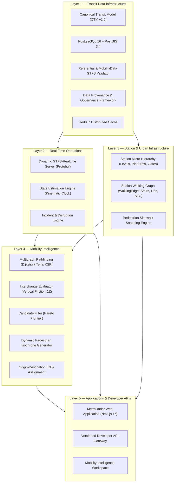
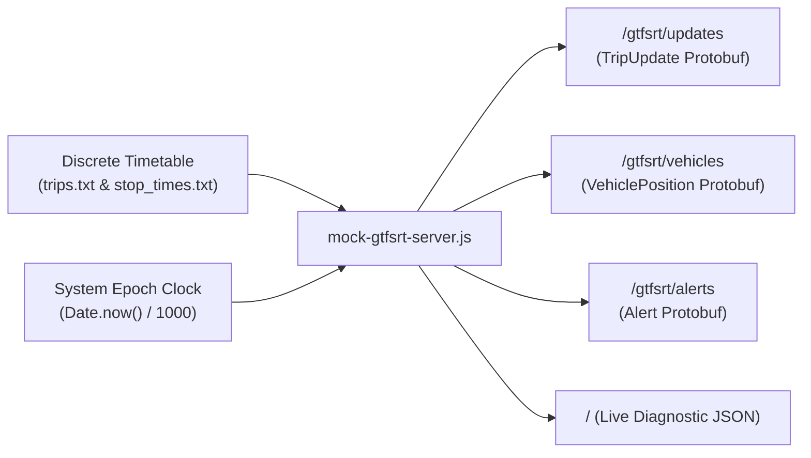
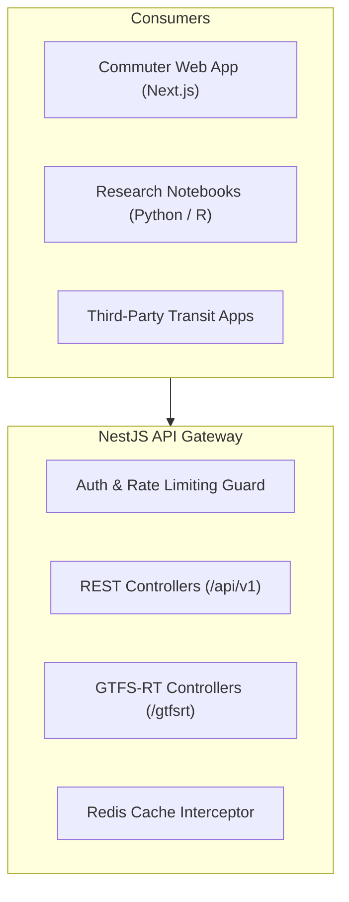

# TransitOS — System Architecture Reference

This document describes the computational architecture, data infrastructure, canonical transit model, spatial engineering engines, and application boundaries underpinning the **TransitOS** platform. It is intended for software engineers, transport modelers, GIS specialists, and researchers collaborating on or integrating with the platform.

---

## 1. System Overview: The Five-Layer Platform Stack

TransitOS is structured as a five-layer urban transit data and intelligence stack. Each layer possesses a strict ownership boundary, encapsulating internal complexity and exposing clean interfaces to higher tiers.



---

## 2. Layer 1 — Transit Data Infrastructure

The foundation of TransitOS is an authoritative, relational, and spatial representation of transit networks.

### 2.1 Canonical Transit Model (CTM v1.0)
Implemented in PostgreSQL with PostGIS extensions via Prisma ORM, CTM models transit systems as a normalized hierarchy:
* **`systems`**: Metropolitan regions (e.g. `MUMBAI_METRO`).
* **`agencies`**: Operating authorities (e.g. `MMMOCL`, `MMOPL`, `MMRCL`).
* **`lines`**: Physical/service corridors with designated brand colors, text colors, and modes (`METRO`, `MONORAIL`, `SUBURBAN_RAIL`).
* **`stations`**: Parent complexes grouping all platforms, concourses, and access portals.
* **`levels`**: Vertical storeys (`Street`, `Concourse`, `Mezzanine`, `Platform`) indexed by relative elevation (-2, -1, 0, 1, 2).
* **`platforms`**: Track-side boarding areas with platform codes ("1", "2") and wheelchair accessibility flags.
* **`entrances`**: Physical street access portals with verified gate codes (e.g., `A1`, `B1`), street descriptions, and mobility assets (lift, escalator, stairs).
* **`amenities`**: Internal station facilities (TVMs, security screening, restrooms).

### 2.2 Discrete Timetable Engine
Unlike legacy feeds that rely on arbitrary frequency ranges, TransitOS synthesizes and maintains discrete timetables:
* Every individual train dispatch is assigned a unique `trip_id` bound to a specific `service_id` (`SVC_WEEKDAY`, `SVC_SATURDAY`, `SVC_SUNDAY`).
* `stop_times` records capture second-level arrival and departure timestamps:
  $$\text{Dwell Time} = t_{\text{departure}} - t_{\text{arrival}}$$
* Shapes are stored as true PostGIS 3D/2D `LineString` geometries tracing surveyed track alignments.

### 2.3 Automated Conformance & Validation
The data pipeline enforces four levels of automated validation:
1. **Relational Integrity**: Foreign key verification ensuring 0 orphan stops, 0 dangling pathways, and 0 invalid parent stations.
2. **Spatial Bounding**: Coordinate sanity checks ensuring all features exist within surveyed urban boundaries.
3. **Graph Reachability**: Solves station walkability, guaranteeing that every platform has a directed pathway to/from street exits.
4. **Canonical GTFS Validator**: Continuous verification against the Canonical MobilityData GTFS Schedule Validator.

---

## 3. Layer 2 — Real-Time Operations

Real-time operations are managed as an ephemeral, dynamic computation layer decoupled from long-term database storage.



### 3.1 Kinematic State Estimation
When official AVL (Automatic Vehicle Location) transponder feeds are unavailable, TransitOS computes expected train positions dynamically:
1. Reads active service calendar for the current day.
2. Identifies all trips active within the current time slice $[t_{\text{now}} - \delta, t_{\text{now}} + \delta]$.
3. Computes progress $\rho \in [0, 1]$ between consecutive stop coordinates:
   $$\rho = \frac{t_{\text{now}} - t_{\text{dep}, A}}{t_{\text{arr}, B} - t_{\text{dep}, A}}$$
4. Interpolates the exact $(x, y)$ coordinate and bearing angle along the surveyed 3D track alignment shapefile.

### 3.2 Protocol Buffer Serialization
Outputs strictly conform to the GTFS-Realtime v2.0 specification using `gtfs-realtime-bindings`. Streams are encoded as `application/x-protobuf` binary payloads, ready for ingestion by standard journey planners (e.g. OpenTripPlanner, Google Maps, Apple Maps).

---

## 4. Layer 3 — Station & Urban Infrastructure

TransitOS treats stations as multi-dimensional architectural structures rather than 2D coordinate points.

### 4.1 Intra-Station Walking Graph (`WalkingEdge`)
Pedestrian circulation within station complexes is formalized as an explicit directed graph:
* **Horizontal Walkways (`CORRIDOR`)**: Evaluated at standard commuter walking speed ($v_{\text{walk}} = 1.2\text{ m/s}$).
* **Vertical Transitions (`STAIRS`, `ESCALATOR`, `ELEVATOR`)**: Modeled with explicit level deltas ($\Delta Z$). Stairs incur an energy expenditure multiplier ($w_z = 2.5$), escalators move at $0.6\text{ m/s}$, and lifts account for door cycle and dispatch latency ($30\text{–}60\text{ s}$).
* **Fare Boundaries (`AFC_GATE`)**: Automated turnstiles enforce unidirectional flow (`is_bidirectional = 0`) and impose ticket validation time penalties.

### 4.2 Sidewalk Snapping & Street Anchoring
Station gate coordinates are snapped to navigable sidewalk networks:
* Gate nodes are tied to pedestrian edges within a strict 30-meter radius.
* Eliminates "rooftop snapping" or inaccessible arterial highway centroid attachments.

---

## 5. Layer 4 — Mobility Intelligence & Pathfinding

### 5.1 Multi-Corridor Directed Multigraph Formulation
The network graph is instantiated in memory as $G = (V, E)$:
* **$V$**: Set of station platforms, concourse nodes, gate portals, and street junction nodes.
* **$E$**: Directed edges partitioned into:
  * $E_{\text{transit}}$: Inter-station scheduled rail service.
  * $E_{\text{transfer}}$: Multi-line interchange corridors and pedestrian FOBs.
  * $E_{\text{walk}}$: Concourse pathways, stairs, lifts, and street egress links.

### 5.2 Generalized Cost Scoring Function
Every path $P$ is evaluated using a generalized commuter cost function:
$$C(P) = w_{\text{ivt}} \cdot t_{\text{ivt}} + w_{\text{wait}} \cdot t_{\text{wait}} + w_{\text{walk}} \cdot t_{\text{walk}} + w_{\text{transfer}} \cdot N_{\text{transfer}} + \text{IFI}(P) + \text{Fare}(P)$$

Where:
* $t_{\text{ivt}}$: In-vehicle transit time.
* $t_{\text{wait}}$: Headway-dependent wait time.
* $t_{\text{walk}}$: Pure horizontal walking time.
* $N_{\text{transfer}}$: Count of vehicle transfers.
* $\text{IFI}(P)$: Built-environment Interchange Friction Index.

### 5.3 Interchange Friction Index (IFI)
Captures the physical impedance of transfers across built environments:
$$\text{IFI} = \alpha \cdot t_{\text{fob}} + \beta \cdot \sum \Delta Z_{\text{stairs}} + \gamma \cdot N_{\text{turnstiles}}$$

### 5.4 Pareto-Optimal Candidate Filtering (Yen's K-Shortest Paths)
Instead of returning a single shortest path, the routing engine identifies $K$ alternative candidates using Yen's KSP algorithm, filtering the result set across a strict Pareto frontier:
$$\text{Path } A \text{ dominates } B \iff \forall m \in \{\text{Time}, \text{Transfers}, \text{Walking}, \text{Fare}\}, \, M_m(A) \le M_m(B) \land \exists m, \, M_m(A) < M_m(B)$$

### 5.5 Dynamic Pedestrian Isochrones
Computes accessible urban polygons from any station gate across 5, 10, and 15-minute walking thresholds, tracing physical sidewalks, pedestrian bridges, and street crossings while observing natural and infrastructure barriers.

---

## 6. Layer 5 — Applications & Developer APIs

The top tier exposes the platform's data and computational capabilities to end-users and external services:



* **Commuter Experience**: Door-to-door itinerary search, gate-level exit guidance, and station digital twin floor plans.
* **Data Explorer**: Vector-based geospatial map interface visualizing routes, operational status, and catchment polygons.
* **Developer APIs**: High-performance REST endpoints for network topology, itineraries, digital twins, and GTFS archives.

---

## 7. Spatial Database Design & PostGIS Architecture

All spatial entities utilize standard PostGIS geometry columns:
```sql
-- Geometry columns use SRID 4326 (WGS 84)
ALTER TABLE stations ADD COLUMN geom geometry(Point, 4326);
ALTER TABLE entrances ADD COLUMN geom geometry(Point, 4326);
ALTER TABLE shapes ADD COLUMN geom geometry(LineString, 4326);
ALTER TABLE isochrones ADD COLUMN geom geometry(Polygon, 4326);

-- Spatial GIST indexes for ultra-fast spatial querying
CREATE INDEX idx_stations_geom ON stations USING GIST(geom);
CREATE INDEX idx_entrances_geom ON entrances USING GIST(geom);
CREATE INDEX idx_shapes_geom ON shapes USING GIST(geom);
CREATE INDEX idx_isochrones_geom ON isochrones USING GIST(geom);
```

### Trigger-Based Spatial Synchronization
PostgreSQL triggers automatically update `geom` columns whenever `latitude` or `longitude` coordinates are inserted or modified:
```sql
CREATE OR REPLACE FUNCTION sync_geom_from_latlon()
RETURNS TRIGGER AS $$
BEGIN
    IF NEW.latitude IS NOT NULL AND NEW.longitude IS NOT NULL THEN
        NEW.geom := ST_SetSRID(ST_MakePoint(NEW.longitude, NEW.latitude), 4326);
    END IF;
    RETURN NEW;
END;
$$ LANGUAGE plpgsql;
```

---

## 8. Technology Stack Reference

| Component | Technology | Version | Architectural Role |
| :--- | :--- | :--- | :--- |
| **Backend Framework** | NestJS | 11.x | Modular API gateway, microservices, dependency injection. |
| **Language** | TypeScript | 5.7+ | Full-stack type safety across backend and frontend. |
| **Runtime** | Node.js | 22 LTS | High-performance asynchronous execution engine. |
| **ORM** | Prisma | 6.x | Type-safe schema migrations, queries, and relations. |
| **Relational Database** | PostgreSQL | 16.x | Relational storage for schedules, CTM, and system metadata. |
| **Spatial Engine** | PostGIS | 3.4+ | Geospatial indexing, buffers, isochrones, and vector processing. |
| **Distributed Cache** | Redis | 7.x | Graph serialization, route candidate caching, live vehicle state. |
| **Frontend Framework** | Next.js (App Router) | 16.x | Server-rendered commuter UI with Turbopack and React 19. |
| **Map Rendering** | MapLibre GL JS | 4.x | WebGL client-side vector tile and GeoJSON visualization. |
| **Realtime Protocol** | Protocol Buffers | 2.0 | High-efficiency binary serialization for GTFS-RT feeds. |
| **Styling** | Tailwind CSS + shadcn/ui | 3.x | Modern, responsive, accessible UI design system. |
