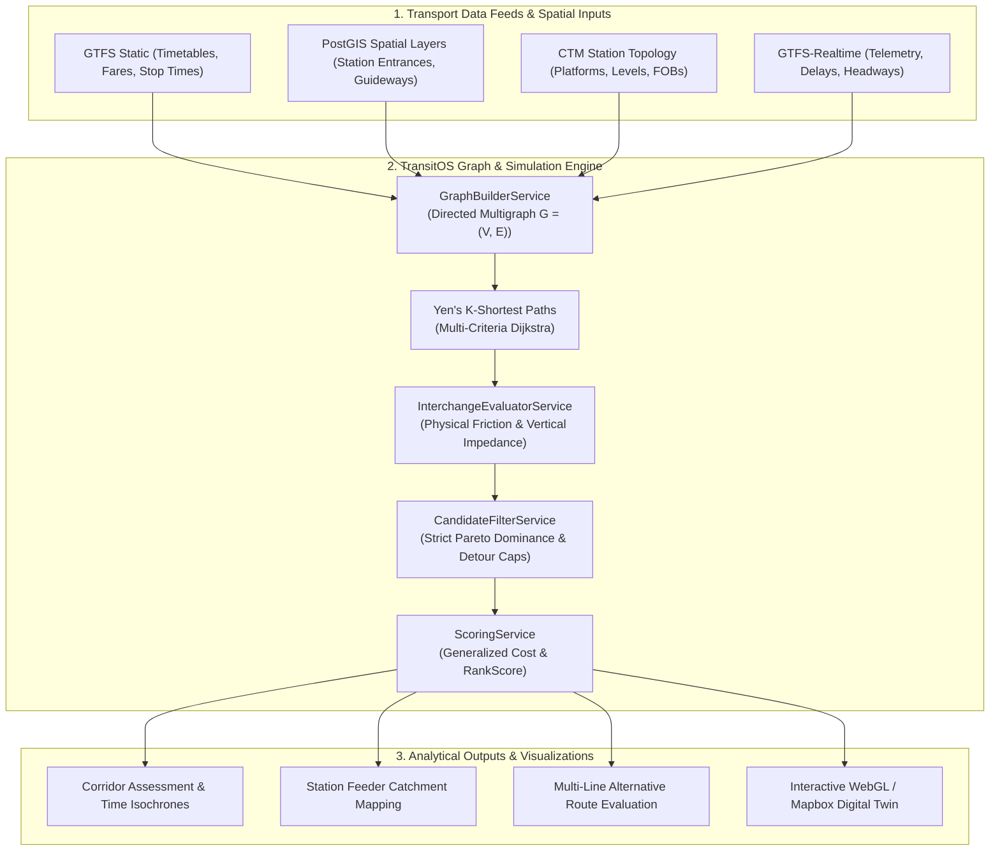

# TransitOS 🚇📡
### Computational Transit Modeling, Corridor Assessment & Multi-Modal Simulation Engine
*(Project MetroRadar)*

[](https://metro-radar-blush.vercel.app)
[](https://transitos-33xk.onrender.com/health)
[](https://nestjs.com/)
[](https://www.postgresql.org/)
[](https://redis.io/)
[](https://nextjs.org/)
[](https://github.com/Gautam2665/MetroRadar)
[](LICENSE)

> ### 🌐 Live Telemetry & Applications
> * **Interactive Corridor Assessment Platform:** [https://metro-radar-blush.vercel.app](https://metro-radar-blush.vercel.app)
> * **Computational Routing API Gateway:** [https://transitos-33xk.onrender.com](https://transitos-33xk.onrender.com)
> * **Live Network Health & Operational Probe:** [https://transitos-33xk.onrender.com/health](https://transitos-33xk.onrender.com/health)

---

## 🏛️ Executive Summary for Transport Planners & Engineers

**TransitOS** is a specialized transport-planning and mobility-analytics engine designed to evaluate **mass transit corridors, multi-modal station catchments, network connectivity, and passenger impedance under varying operational scenarios**.

Traditional transit planning tools often treat stations as 2D spatial centroids and routes as static timetable lookups, ignoring the physical reality of vertical level changes, pedestrian interchange geometry, turnstiles, and natural/infrastructure barriers. TransitOS bridges this gap by marrying an authoritative relational **Canonical Transit Model (CTM v1.0)** in PostgreSQL/PostGIS with an in-memory **Time-Dependent Directed Multigraph routing engine**.

The platform is designed to answer fundamental transport planning and feasibility questions:
1. **Corridor Utility & Travel Flows**: How do alternative alignments alter passenger diversion, in-vehicle travel times, and transfer frequency?
2. **Station Catchment & Feeder Integration**: How do station relocations affect walking isochrones, first/last-mile feeder catchments, and integration with suburban rail, buses, and airports?
3. **Micro-Interchange Built-Environment Friction**: How do Foot Overbridges (FOBs), vertical elevation changes ($\Delta Z$), turnstiles (AFC), and security screening perimeters alter passenger route choice?
4. **Scenario Testing & Operational Sensitivity**: What happens to network loading and connection reliability when headway, cruise speed, dwell times, or safety buffers are modified?

---

## 🔬 Core Transport Engineering Capabilities



### 1. Multi-Corridor Graph Formulation ($G = (V, E)$)
The transit network is compiled into an in-memory directed multigraph where:
- **Vertices ($V$)**: Represent station concourses, platforms, and multi-modal gate attachments with high-precision coordinates.
- **Edges ($E$)**: Categorized into discrete, typed segments:
  - `EdgeType.TRANSIT`: Inter-station revenue service derived from timetable arrival/departure differentials or kinematic distance/speed profiles:
    $$T_{ij} = \frac{d_{ij}}{v_{\text{cruise}}} + t_{\text{accel/decel}} + t_{\text{dwell}}$$
  - `EdgeType.TRANSFER`: Station-to-station pedestrian transfer corridors (elevated FOBs, subterranean walkways).
  - `EdgeType.WALK`: Concourse vertical ascents/descents, platform cross-overs, and egress links.

### 2. Built-Environment Interchange Friction Modeling
Interchanges are not treated as instantaneous node jumps. Our `InterchangeEvaluatorService` calculates impedance across the physical transit environment:
- **Horizontal Walkway Traversal**: Concourse length evaluated at standard commuter walking speed ($1.2\text{ m/s}$).
- **Vertical Elevation Displacement ($\Delta Z$)**: A penalty of **$+10\text{ seconds per vertical meter}$** is applied to simulate stair/escalator fatigue, particularly critical for heavy luggage or passenger mobility constraints.
- **Fare Control Penalties (AFC Re-tap)**: **$+60\text{ seconds}$** applied if transfers require exiting the paid area through turnstiles versus staying inside a seamless paid concourse.
- **Security Perimeter Rescreening**: **$+300\text{ seconds}$ (+5 minutes)** penalty applied when passenger flows intersect airport or railway security baggage-scanning perimeters.
- **Weather & Street Exposure**: **$+600\text{ seconds}$** penalty for open-air street-level walking between stations compared to enclosed, grade-separated, climate-controlled links.

### 3. Dynamic Relative Feeder Catchment (GIS Layer)
Rather than imposing rigid, artificial radial distance caps that mischaracterize outer suburban trips, TransitOS implements a **relative proximity feeder model**:
$$\text{FeederCutoff} = \max\left(d_{\min} + 1500\text{m}, \; d_{\min} \times 1.6\right)$$
- $\le 1.2\text{ km}$: Evaluated as **Pedestrian Walking Catchment**.
- $> 1.2\text{ km}$: Automatically classified as a **Vehicular Feeder Corridor** (Auto-rickshaw / Feeder Bus).
- Identifies nearest feeder stations per active line across the metropolitan region, providing clear visibility into multi-modal access legs.

### 4. Barrier-Crossing & Divide-Aware Network Routing
In dense metropolises, natural features (rivers, wetlands) and heavy infrastructure (multi-track suburban railway trunks) create severe physical divides where road-based crossing is choked by severe traffic bottlenecks.
- The engine dynamically evaluates passenger destination coordinates against infrastructure divide coordinates (e.g., the Western Railway divide in Mumbai at Longitude $72.851$).
- A multi-line transfer that utilizes elevated metro viaducts to fly over the railway barrier is mathematically prioritized over a direct single-line run that leaves the commuter stranded on the wrong side of the tracks, accurately reflecting commuter behavior.

### 5. Multi-Criteria Pareto Dominance & Detour Elimination
Candidate routes generated via Yen’s $K$-Shortest Paths are filtered through strict multi-objective optimization:
$$\text{Route } B \text{ dominates } A \iff T_B \le T_A \;\land\; \text{Xfer}_B \le \text{Xfer}_A \;\land\; \text{Walk}_B \le \text{Walk}_A$$
- **Circuitous Detour Suppression**: When two candidates terminate at the same destination station, a route with strictly more transfers is pruned if it is $> 15\%$ slower or $> 5\text{ minutes}$ slower.
- **Corridor Diversity Preservation**: When traveling to multi-feeder localities, alternative destination stations on different lines are explicitly protected from false dominance, allowing planners to compare access via multiple corridors.

---

## 📊 Analytical Sensitivity: What Changes Under Scenario Alterations?

When assessing transit scenarios, TransitOS allows engineers to modify key inputs and observe deterministic outputs:

| Scenario Alteration | Technical Mechanism in Engine | What Changes in the Network Model |
| :--- | :--- | :--- |
| **Altering a Corridor Alignment** | Modifies directed edges $E_{\text{transit}}$ and CTM sequence geometries. | Recomputes in-vehicle travel times ($T_{\text{in-vehicle}}$), eliminates circuitous detours, re-routes regional passenger flows, and creates new transfer opportunities at corridor intersections. |
| **Relocating a Station** | Shifts PostGIS entrance coordinates (`geom`); re-runs spatial joins. | Modifies station catchment isochrones; transitions passenger catchment between pedestrian walk ($\le 1.2\text{km}$) and vehicular feeder modes; shifts barrier-crossing alignment relative to congested road overpasses. |
| **Changing Service Headway** | Modifies schedule frequency in timetable simulation. | Alters initial waiting time ($W_{\text{initial}} = H/2$) and interchange connection wait times ($W_{\text{transfer}}$); alters modal competitiveness against personal motor vehicles. |
| **Adjusting Connection Safety Buffer ($B_{\text{safety}}$)** | Modifies feasibility threshold: $T_{\text{arr}} + T_{\text{walk}} + B_{\text{safety}}$. | Reclassifies transfers between `SAFE` and `BUFFERED` (high risk); identifies tight connection bottlenecks where passengers risk missing trains. |
| **Upgrading Interchange Infrastructure** (e.g. Adding Skywalk / FOB) | Removes turnstile exit penalty ($-60\text{s}$) and security re-screening ($-300\text{s}$); reduces $D_{\text{pathway}}$. | Reduces generalized interchange friction ($C_{\text{friction}}$); turns an avoided transfer into a preferred regional transit corridor. |

---

## 🧮 Mathematical Formulation

### Generalized Cost & Display Ranking Function
Every candidate route is evaluated against a generalized cost equation that balances perceived passenger impedance:

$$\text{RankScore} = 0.6 \cdot T_{\text{duration}} + 120 \cdot N_{\text{transfers}} + 0.2 \cdot T_{\text{walking}} + C_{\text{interchange\_friction}}$$

Where:
- $T_{\text{duration}}$: Total elapsed journey time (In-vehicle + Walking + Waiting in seconds).
- $N_{\text{transfers}} \times 120$: Psychological penalty equivalent to **2 minutes of in-vehicle time per line transfer**.
- $0.2 \cdot T_{\text{walking}}$: Additional penalty weighting walking fatigue significantly higher than passive in-vehicle sitting.
- $C_{\text{interchange\_friction}}$: Sum of physical built-environment penalties (vertical climbs, ticket gates, security queues).

---

## 🗺️ Empirical Network Coverage: Mumbai CTM v1.0

TransitOS models the Mumbai Metropolitan Region (MMR) transit network with complete micro-topological fidelity:

* **Line 1 (Blue Line)**: Versova ↔ Andheri ↔ Western Express Highway ↔ Marol Naka ↔ Ghatkopar (11.4 km)
* **Line 2A (Yellow Line)**: Dahisar East ↔ Borivali West ↔ D.N. Nagar / Andheri West (18.6 km)
* **Line 3 (Aqua Line)**: Aarey JVLR ↔ Marol Naka ↔ BKC ↔ Worli ↔ Cuffe Parade (33.5 km underground spine)
* **Line 7 (Red Line)**: Dahisar East ↔ Magathane ↔ Goregaon East ↔ Gundavali (16.5 km)
* **Interchange Complexes Modeled**:
  - `ICX-WEH-GUNDAVALI`: Line 1 (Elevated) ↔ Line 7 (Elevated) via 58-meter grade-separated Foot Overbridge (FOB).
  - `ICX-DN-NAGAR`: Line 1 (D.N. Nagar) ↔ Line 2A (Andheri West) multi-level concourse interchange.
  - `ICX-MAROL-NAKA`: Line 1 (Elevated) ↔ Line 3 (Underground) cross-depth transfer with vertical elevation profiling.
  - `ICX-DAHISAR-EAST`: Continuous cross-platform concourse interchange between Line 2A and Line 7.

---

## 💻 Tech Stack & Engineering Specifications

* **Backend & Routing**: NestJS 11, TypeScript 5.7, Node.js v22
* **Spatial Database**: PostgreSQL 16 + PostGIS (geodetic calculations via `geography` types)
* **ORM & Migrations**: Prisma 6.2 with customized PostGIS spatial extensions
* **Graph Caching**: Redis 7.2 (in-memory multi-corridor transit graph caching)
* **Frontend Web Application**: Next.js 16 (App Router, Turbopack, Tailwind CSS v4)
* **Geospatial Visualization**: Mapbox GL / MapLibre GL, GeoJSON FeatureCollections, WebGL train simulation
* **Testing & Quality Assurance**: Jest test suite with **63 automated assertions** covering Pareto dominance, detour pruning, scoring accuracy, and transit graph construction.

---

## 📁 Monorepo Structure

```
MetroRadar/ (TransitOS Engine Monorepo)
├── apps/
│   ├── backend/        # NestJS Transport Modeling Engine
│   │   ├── src/modules/journey/routing/  # Yen's K-SP, Pareto filter, scoring service
│   │   ├── src/modules/journey/graph/    # Multigraph builder & topological compiler
│   │   ├── src/modules/gis/              # Spatial search, relative catchments, PostGIS queries
│   │   └── src/modules/realtime/         # GTFS-RT feed ingestion & delay propagation
│   └── frontend/       # Next.js 16 Web Application (Mapbox GL, Stitch UI, Journey Planner)
├── database/
│   └── prisma/         # Relational CTM schema (schema.prisma), seed data, PostGIS DDL
├── datasets/           # Authoritative GTFS datasets, interchange manifests, pathway specs
├── packages/           # Shared types and configuration libraries
├── ARCHITECTURE.md     # In-depth architectural specification manual
├── GTFS_SYNTHESIS.md   # Transit Data Synthesis Engine (TDSE) methodology
└── README.md           # Master documentation (this file)
```

---

## 🚀 Installation & Local Environment Setup

### Prerequisites
* **Node.js** (v20+ LTS recommended)
* **Docker & Docker Compose**
* **PostgreSQL 16 with PostGIS**
* **Redis**

### Step-by-Step Setup

1. **Clone the repository:**
   ```bash
   git clone https://github.com/Gautam2665/MetroRadar.git
   cd MetroRadar
   ```

2. **Configure Environment Variables:**
   ```bash
   cp .env.example .env
   ```

3. **Install Monorepo Dependencies:**
   ```bash
   npm install
   ```

4. **Launch Database & Cache Containers:**
   ```bash
   docker-compose up -d
   ```

5. **Deploy Database Schema & CTM Models:**
   ```bash
   npm run db:generate
   npm run db:push
   ```

6. **Start Local Development Instances:**
   ```bash
   # Start Backend Engine (http://localhost:3001)
   npm run start:dev --workspace=apps/backend

   # Start Frontend Application (http://localhost:3000)
   npm run dev --workspace=apps/frontend
   ```

---

## 🧪 Automated Verification & Testing

Every routing change, dominance filter rule, and graph compilation is guarded by automated test suites:

```bash
# Execute all backend transport modeling unit tests (63 tests)
npm run test:backend

# Run targeted candidate-filter and dominance test suite
npx jest --config apps/backend/package.json apps/backend/src/modules/journey/routing/candidate-filter.service.spec.ts

# Production build validation
npm run build:backend
npm run build:frontend
```

---

## 📄 License
This project is open-source under the [MIT License](LICENSE).
