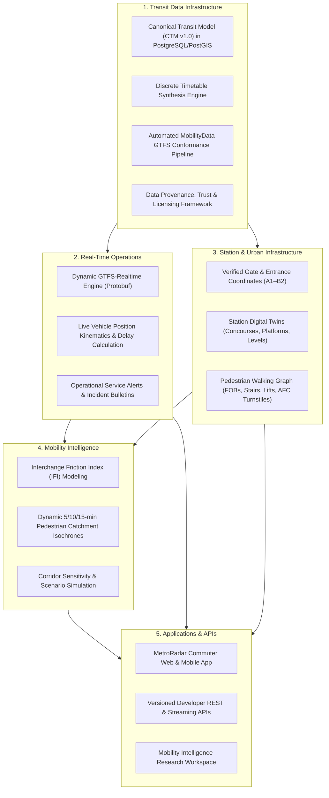

# TransitOS 🚇📡
### Transit Data Infrastructure & Mobility Intelligence
*(Project MetroRadar)*

[](https://metro-radar-blush.vercel.app)
[](https://transitos-33xk.onrender.com/health)
[](https://nestjs.com/)
[](https://www.postgresql.org/)
[](https://redis.io/)
[](https://nextjs.org/)
[](https://gtfs-validator.mobilitydata.org/)
[](LICENSE)

> **TransitOS** is a geospatial transit data platform that transforms fragmented urban transit information into a connected, validated, and queryable digital representation of transit networks.
> 
> It combines a canonical transit data model, spatial infrastructure, pedestrian connectivity, transit routing, and versioned developer APIs to support passenger applications, transit data exploration, and mobility research.
> 
> Built initially around Mumbai's urban transit networks, TransitOS aims to provide a reusable technical foundation for developers, researchers, transit operators, and public-sector mobility initiatives across Indian metropolitan regions.

---

## 🌐 Live Services & Platform Endpoints

* **Interactive Commuter & Data Explorer Platform:** [https://metro-radar-blush.vercel.app](https://metro-radar-blush.vercel.app)
* **REST API Gateway:** [https://transitos-33xk.onrender.com/api/v1](https://transitos-33xk.onrender.com)
* **Health & Operational Telemetry Probe:** [https://transitos-33xk.onrender.com/health](https://transitos-33xk.onrender.com/health)
* **GTFS Realtime (Protobuf Stream):** `https://transitos-33xk.onrender.com/gtfsrt/updates`

---

## 🏛️ The Five-Layer Platform Stack

TransitOS organizes transit data and services into five modular, interoperable layers. Rather than treating transit data as disjointed files, each layer builds directly upon the validated foundation below:



### 1. Transit Data Infrastructure
* **Canonical Relational Modeling**: Centralized in PostgreSQL 16 with PostGIS 3.4 spatial types and GIST indexing.
* **Authoritative GTFS Schedule Synthesis**: Verified discrete schedules (`datasets/mumbai/mumbai_discrete_ready.zip`) compliant with Canonical MobilityData validator standards (0 errors).
* **Data Provenance & Governance**: Explicit tracking of public, restricted, independently curated, and operational data tiers.

### 2. Real-Time Operations
* **Dynamic GTFS-RT Protobuf Streaming**: Live serialization of `FeedMessage` objects providing `/gtfsrt/updates`, `/gtfsrt/vehicles`, and `/gtfsrt/alerts`.
* **State Estimation & Kinematic Progression**: Dynamic headway tracking and arrival predictions matched to active service calendars.

### 3. Station & Urban Infrastructure
* **Sub-Station Micro-Spatial Geometry**: Complete vertical hierarchy modeling `System → Agency → Line → Station → Level → Platform / Entrance / Amenity`.
* **Gate-Level Precision**: Exact ground-truthed street access coordinates (e.g. Churchgate Gates A1–A5, B1–B2) snapped directly onto pedestrian sidewalk networks.
* **Physical Interchange Links**: Intra-station walking edges with explicit impedance values for Foot Overbridges (FOBs), subterranean passages, escalators, and accessible lifts.

### 4. Mobility Intelligence
* **Pedestrian Catchment Isochrones**: 5, 10, and 15-minute walking polygons computed along physical street networks rather than simple radial circles.
* **Interchange Friction Index (IFI)**: Empirical mathematical modeling of passenger impedance across vertical level changes ($\Delta Z$), turnstiles (AFC), and long corridors.
* **Network Scenario Simulation**: Corridor modification, headway sensitivity, and resilience testing for transport researchers and planners.

### 5. Applications & Developer APIs
* **MetroRadar Commuter Interface**: Clean, accessible passenger journey planning with door-to-door itineraries and gate navigation.
* **Data Explorer**: Spatial map interface visualizing multi-line transit layers, transfer hubs, and digital twin layouts.
* **Developer APIs**: Versioned REST and streaming endpoints powering third-party mobile apps, research notebooks, and operational tools.

---

## 🔬 Core Engineering & Routing Capabilities

While TransitOS serves as a complete data platform, its underlying mathematical and spatial routing engines remain foundational engineering achievements:

### Multi-Corridor Directed Multigraph ($G = (V, E)$)
The transit network is compiled into an in-memory directed multigraph where:
* **Vertices ($V$)**: Represent station concourses, platforms, and street gates with high-precision coordinates and level identifiers.
* **Edges ($E$)**: Categorized into discrete, typed segments:
  * `EdgeType.TRANSIT`: Inter-station revenue service derived from timetable arrival/departure differentials or kinematic profiles:
    $$T_{ij} = \frac{d_{ij}}{v_{\text{cruise}}} + t_{\text{accel/decel}} + t_{\text{dwell}}$$
  * `EdgeType.TRANSFER`: Station-to-station pedestrian transfer corridors (elevated FOBs, subterranean walkways).
  * `EdgeType.WALK`: Concourse vertical ascents/descents, platform cross-overs, and egress links.

### Built-Environment Interchange Friction Modeling
Interchanges are not treated as instantaneous node jumps. Our `InterchangeEvaluatorService` calculates realistic impedance:
$$\text{Cost}_{\text{transfer}} = \alpha \cdot t_{\text{walk}} + \beta \cdot \Delta Z_{\text{up}} + \gamma \cdot \Delta Z_{\text{down}} + \delta \cdot N_{\text{turnstiles}} + \epsilon \cdot t_{\text{wait}}$$
Where vertical stairs carry high energy impedance ($w_z = 2.5$), mechanized escalators move at $0.6\text{ m/s}$, and accessible lifts account for door cycle wait times.

### Pareto-Optimal Alternative Routing (Yen's K-Shortest Paths)
Rather than returning a single deterministic path, TransitOS computes $K$-alternative candidate itineraries filtered across Pareto frontiers (In-Vehicle Time vs. Physical Transfer Walking vs. Fares).

---

## 🗺️ Multi-City Regional Roadmap

Inspired by the [Delhi Transport Stack](https://delhi.transportstack.in/) and [Chartr](https://www.chartr.in/), TransitOS follows a disciplined, repeatable process across metropolitan regions:

```
Stage 1: Mumbai (Active Baseline)
├── Metro Lines 1, 2A, 2B, 3, 7, 9 & Monorail
├── Western & Central Railway Suburban Rail Interchange FOBs
└── Verified Gate Coordinates & 100% GTFS Conformance

Stage 2: Pune (Phase 2)
├── Pune Metro Purple & Aqua Lines
└── PMPML Bus Network Integration & Shared Interchange Nodes

Stage 3: Nagpur (Phase 3)
├── Maha Metro Orange & Aqua Lines
└── Station Access & Feeder Catchment Pipelines

Stage 4: Cross-City Intelligence
└── Comparative Network Accessibility & Transfer Benchmarking
```

---

## 📚 Project Documentation & References

Explore our detailed engineering and product documentation:

* **Platform Vision & Strategy**:
  * [Product Overview](./docs/vision/product-overview.md) — Platform vision, core products, and stakeholder use cases.
  * [Product & Growth Strategy](./docs/vision/product-strategy.md) — Strategic roadmap, reference models, and academic collaboration.
* **Architecture & Data Models**:
  * [Platform Architecture](./docs/architecture/platform-architecture.md) — Comprehensive 5-layer system design and tech stack.
  * [Canonical Transit Model (CTM v1.0)](./docs/architecture/canonical-transit-model.md) — Relational PostGIS schema and walking graph specification.
* **Data, Quality & Provenance**:
  * [Data & Service Catalogue](./docs/data/data-catalogue.md) — Complete capabilities matrix (P0–P3) and regional coverage.
  * [Data Quality & Validation](./docs/data/data-quality.md) — 4-stage validation pipeline and MobilityData conformance.
  * [Provenance, Licensing & Trust](./docs/data/provenance-and-trust.md) — 4-tier data categorization and confidence scoring.
* **APIs & Mobility Intelligence**:
  * [Developer API Reference](./docs/api/api-overview.md) — REST endpoints, GTFS-RT streaming feeds, and OpenAPI specs.
  * [Station Accessibility & Micro-Mobility](./docs/mobility-intelligence/accessibility.md) — Step-free routing, elevators, and street isochrones.
  * [Mobility Intelligence Analytics](./docs/mobility-intelligence/future-analytics.md) — Interchange Friction Index, OD modeling, and research tracks.
* **Governance**:
  * [Research Integrity & Limitations](./docs/governance/research-and-limitations.md) — Ground truth standards, simulation boundaries, and institutional engagement.

---

## 🚀 Quickstart for Developers

### Prerequisites
* Node.js 22 LTS
* Docker & Docker Compose (for PostgreSQL/PostGIS and Redis)
* npm 10+

### 1. Clone & Install Dependencies
```bash
git clone https://github.com/Gautam2665/MetroRadar.git
cd MetroRadar
npm install
```

### 2. Environment Configuration
Copy `.env.example` to `.env` and set your database connection strings:
```bash
cp .env.example .env
```

### 3. Start Local Database & Infrastructure
```bash
docker-compose up -d
```

### 4. Database Setup & Migrations
```bash
npm run db:migrate --workspace=apps/backend
npm run db:generate --workspace=apps/backend
```

### 5. Start Development Servers
```bash
# Start backend API (NestJS on port 3001)
npm run start:dev --workspace=apps/backend

# Start frontend (Next.js on port 3000)
npm run dev --workspace=apps/frontend
```

### 6. Export Canonical GTFS Archives
To regenerate the 100% compliant GTFS Schedule feeds and repackage zip archives:
```bash
node scripts/export_synchronized_gtfs.js
```

---

## 🤝 Research Collaboration & Institutional Inquiries

TransitOS actively seeks research partnerships with academic institutions, transport planning departments, and public mobility organizations.

* **Academic Partnerships**: Collaborative research on pedestrian transfer friction, accessibility equity, and multi-modal network modeling (e.g. via **IIT Bombay Transportation Systems Engineering / IRCC / SINE** pathways).
* **Open Data Contributors**: See [CONTRIBUTING.md](./CONTRIBUTING.md) for instructions on submitting gate survey data, correcting station geometry, or improving pedestrian sidewalk networks.
* **Licensing**: Core software is released under the [MIT License](LICENSE). Curated spatial datasets are published under the [Open Database License (ODbL)](https://opendatacommons.org/licenses/odbl/).
