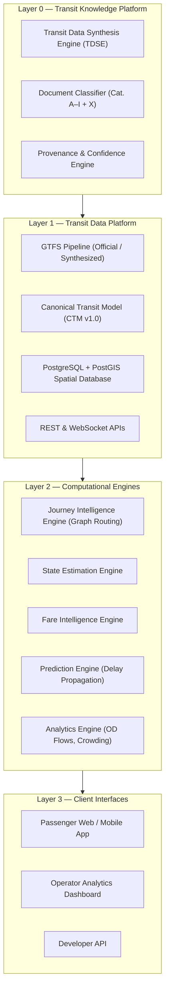

# TransitOS — Development Roadmap

This roadmap documents the phased capability build-out of TransitOS as a computational transit modeling, corridor assessment, and multi-modal simulation platform. Milestones are organized by analytical capability added, not by UI feature delivered.

---

## Platform Architecture

TransitOS is built as four independent, integrated layers. Each phase of development extends one or more layers:

---

## Release Summary

| Version | Milestone | Status |
|:---|:---|:---:|
| v0.1 | Infrastructure and monorepo foundation | Complete |
| v0.2 | Spatial database and CTM schema | Complete |
| v0.3 | GTFS static ingestion engine | Complete |
| v0.4 | Dataset validation CLI and city imports | Complete |
| v0.4.5 | GIS map engine and digital twin inspector | Complete |
| v0.5 | Journey pathfinding engine (Dijkstra) | Complete |
| v0.5.1 | Realtime GTFS-RT ingestion and Redis pipeline | Complete |
| v0.5.5 | National GTFS certification and CTM v1.0 freeze | Complete |
| v0.6 | Multi-candidate routing (Yen's KSP), Pareto filtering | Complete |
| v0.6.5 | National transit expansion and calibration baseline | Active |
| v0.7 | Prediction engine and operational intelligence | Planned |
| v0.8 | Network analytics and operator intelligence | Planned |
| v0.9 | AI interface gateway and voice prototype | Planned |
| v1.0 | Fare engine and booking platform | Planned |
| v1.1+ | Ambient computing and multi-client interfaces | Planned |

---

## Phase 1 — Core Transport Analysis Platform

### v0.1 — Infrastructure Foundation (Complete)

Monorepo configuration, shared tooling, Docker containers for PostgreSQL/PostGIS and Redis, NestJS backend and Next.js frontend scaffold.

### v0.2 — Spatial Database and Canonical Transit Model (Complete)

PostGIS extension enabled. Prisma schema for the Canonical Transit Model (CTM): Systems, Agencies, Lines, Stations, Levels, Platforms, Entrances, Amenities, Trips, StopTimes, Shapes, Calendars. GIST spatial indexes on all geometry columns. Trigger-based geometry sync from `latitude`/`longitude` floats to PostGIS `geometry(Point, 4326)`.

### v0.3 — GTFS Static Ingestion Engine (Complete)

Transaction-safe GTFS zip archive importer. Validation pipeline (checksum, bounding box, referential integrity). Supports `trips.txt`, `stop_times.txt`, `shapes.txt`, `frequencies.txt`, `calendar_dates.txt`. IngestionSession tracking per import run with per-entity counts, warnings, and errors.

### v0.4 — Dataset Validation CLI and City Imports (Complete)

Command-line dataset validation and import tool. Official GTFS feeds for Delhi (DMRC, Tier A) and Kochi (KMRL, Tier A) imported and certified. 5-stage governance lifecycle: `DISCOVERED → ACQUIRED → VALIDATED → CERTIFIED → IMPORTED`.

### v0.4.5 — GIS Map Engine and Digital Twin Inspector (Complete)

MapLibre GL vector map rendering. Dynamic layer registry (`GET /map/layers`) — backend controls layer configuration; client renders automatically. `DigitalTwinService` assembling composite station payloads (levels, platforms, entrances, amenities). Spatial search (`GET /map/search`) and proximity query (`GET /map/nearby`) endpoints backed by PostGIS.

### v0.5 — Journey Pathfinding Engine (Complete)

In-memory directed multigraph G=(V,E) with typed edges (TRANSIT, WALK, TRANSFER). Dijkstra-based routing with configurable weights. Walk transfer edges inserted automatically for stations within interchange radius. `GET /journeys` endpoint returning leg-by-leg itinerary, GeoJSON route geometry, and per-leg metadata.

**Key fixes in this phase:** Dhaula Kuan travelator routing (correct 3-leg path via Airport Express); same-line walk edge elimination.

### v0.5.1 — Realtime GTFS-RT Telemetry (Complete)

`FeedPollerService` background scheduler for GTFS-Realtime feeds. `GtfsRtParserService` decoding binary Protocol Buffer streams. Redis cache with 30-second TTL; stale fallback with `isStale: true` flag. `GET /realtime/vehicles` endpoint with sub-5 ms reads from cache.

### v0.5.5 — National GTFS Certification and CTM v1.0 Freeze (Complete)

5-stage certification governance pipeline. Trust Tier system: Tier A (official), Tier B (community), Tier X (synthesized). 5-dimension quality scorer (100-point scale: completeness, consistency, accuracy, timeliness, coverage). 6 metro networks certified and imported: Delhi, Kochi, Hyderabad, Bengaluru, Chennai, Ahmedabad. **CTM v1.0 schema declared frozen.**

National Transit Status Dashboard generated (`datasets/reports/INDIA_TRANSIT_STATUS.md`). Individual system audit reports (`CERTIFICATION_*.md`).

### v0.6 — Multi-Candidate Routing and Corridor Analysis (Complete)

**Yen's K-Shortest Loopless Paths** algorithm generating up to K=5 candidate routes. Two-stage filtering pipeline:
- Feasibility filter: eliminates loops, invalid durations, excessive transfers
- Pareto dominance filter: prunes strictly inferior candidates across duration, transfers, and walking distance

**Same-destination awareness**: among candidates deboarding at the same station, prune if >15% slower or >5 min longer with equal or more transfers. Different-destination candidates preserved to represent corridor diversity.

Explicit waiting time model (`TimeEstimate` with `source: 'estimated' | 'schedule' | 'live'`). Structured `RouteCandidate` schema with boolean attribute flags (`fastest`, `fewestTransfers`, `direct`, `leastWalking`, `accessibilityFriendly`).

Interchange friction model (`InterchangeEvaluatorService`): built-environment penalties for level changes (+10 s/m), AFC re-tap (+60 s), security rescreening (+300 s), outdoor street exposure (+600 s). `frictionLevel` label exposed in response.

63 automated tests covering candidate generation, Pareto filtering, interchange evaluation, feeder catchment, and barrier-aware routing.

**Key fixes:** Yamuna Bank ↔ Dwarka Sector 21 — direct Blue Line preserved alongside multi-transfer path; NMIA ↔ Malad — Airport Express multi-transfer route preserved; Mumbai railway divide barrier routing; gate result suppression in GIS search.

---

## Phase 2 — Expanded Network Coverage and Calibration

### v0.6.5 — National Transit Expansion and Calibration Baseline (Active)

**Capability addition:** Extend CTM coverage to all major operational networks. Establish the empirical calibration foundation before building prediction models.

**Deliverables:**

- **Mumbai CTM Baseline:** Synthesize and model Mumbai Metro Lines 1 (Blue), 2A (Yellow), 7 (Red), 3 (Aqua underground) using TDSE synthesis from DPRs, timetables, and OSM geometry. Add suburban railway interchange walk paths (Ghatkopar, Andheri, Dadar).
- **Tier-2 Network Baselines:** Ingest Pune, Nagpur, and remaining uncovered networks.
- **Calibration and Observation Platform schema:** Observation data models (station run times, dwell times, transfer walk times, GPS traces, headways). Field telemetry ingestion pipeline. Calibration Data Warehouse in PostgreSQL.
- **Full provenance metadata across all CTM entities:** `sourceType: "OFFICIAL" | "COMMUNITY" | "SYNTHESIZED" | "OBSERVED"`, `confidence: 0.0–1.0`.
- **Multi-city frontend activation:** Dynamic city switcher across all certified networks.

---

## Phase 3 — Operational Intelligence

### v0.7 — Prediction Engine and Delay Propagation (Planned)

**Capability addition:** Probabilistic ETA forecasting and delay propagation modeling using the combined CTM (schedule + historical warehouse + calibration data).

**Deliverables:**
- Prediction Engine consuming scheduled GTFS, historical delay distributions, and calibration warehouse data
- Live delay propagation model: how a delay at one station propagates through following stops
- Empirically learned dwell time and headway distributions replacing default physics assumptions
- Estimated fleet-state digital twins for all modeled networks
- Proactive push notification service for service interruptions

### v0.8 — Network Analytics and Operator Intelligence (Planned)

**Capability addition:** System-level performance analysis, bottleneck detection, and capacity utilization modeling.

**Deliverables:**
- Line efficiency metrics and transfer friction heatmaps
- Station crowding index and capacity utilization forecasting
- Network bottleneck identification (sections with highest delay frequency/magnitude)
- Operator intelligence dashboard with performance trends

---

## Phase 4 — Interface and Commerce

### v0.9 — AI Interface Gateway and Voice Prototype (Planned)

**Capability addition:** Vendor-independent AI interface layer. All transit computation remains on TransitOS engines; AI provides natural language and voice interfaces only.

**Deliverables:**
- Intelligence Gateway routing logic (classify whether query can be answered by deterministic API or requires LLM)
- Sarvam AI integration for Indian-language speech recognition and text-to-speech
- Telegram Voice Bot laboratory prototype for conversational journey planning

### v1.0 — Fare Engine and Booking Platform (Planned)

**Capability addition:** Multi-tier fare computation, integrated booking, and payment abstraction.

**Deliverables:**
- Fare Intelligence Engine: zone pricing, flat rates, transfer discounts, fare capping, pass optimization
- Booking Engine with provider adapter pattern (operator ticketing APIs, ONDC buyer application adapter)
- Payment Abstraction Layer (UPI, Card, NCMC, partner wallets) — platform never holds user funds

### v1.1+ — Multi-Client and Ambient Computing (Planned)

**Capability addition:** Extend analytical and passenger-facing functionality to additional client surfaces.

**Deliverables:**
- WhatsApp Business conversational ticketing interface
- Wear OS smartwatch client (next train ETAs, platform guidance, transfer steps)
- Proactive calendar-to-transit recommendations
