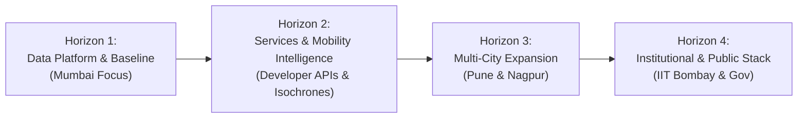

# TransitOS — Strategic & Technical Roadmap

This roadmap defines the phased evolution of **TransitOS** from an urban transit data infrastructure foundation into a multi-city mobility intelligence platform and institutional transit stack.

Milestones are organized by structural capability delivered across the platform's five layers, rather than isolated user-interface tweaks.

---

## 🏛️ Platform Strategic Horizons

---

## 🗺️ Milestone Release Overview

| Version | Milestone | Scope & Core Deliverables | Status |
| :--- | :--- | :--- | :---: |
| **v0.1** | Infrastructure Foundation | Monorepo structure, Docker Compose (PostGIS/Redis), NestJS backend, Next.js frontend. | Complete |
| **v0.2** | Canonical Transit Model (CTM) | Relational PostGIS schema, spatial entities, GIST indexing, trigger geometry sync. | Complete |
| **v0.3** | GTFS Ingestion & Parsing | Zip archive ingestion, referential integrity validator, transactional session logging. | Complete |
| **v0.4** | Multi-System Conformance | Discrete timetable validation, 5-stage lifecycle governance, multi-agency schema support. | Complete |
| **v0.5** | Core Graph & Digital Twins | In-memory directed multigraph, Dijkstra pathfinding, station digital twin inspector. | Complete |
| **v0.5.5** | Micro-Interchange & Walkability | Ground-truthed gate survey coordinates, FOB links, vertical elevation changes ($\Delta Z$). | Complete |
| **v0.6** | Multi-Candidate Routing & Pareto | Yen's K-Shortest Paths, Pareto frontier filtering, Interchange Friction Index (IFI). | Complete |
| **v0.6.5** | Discrete GTFS & Conformance Baseline | 100% MobilityData validator passing (0 errors), discrete timetable synthesis, GTFS-RT engine. | **Production Baseline** |
| **v0.7** | Data Explorer & Developer Portal | Public dataset downloads, OpenAPI Swagger documentation, vector layer registry, API keys. | **Active Development** |
| **v0.8** | Mobility Intelligence Workspace | Dynamic 5/10/15-min pedestrian isochrones, station catchment analytics, transfer friction audit. | **Q1 2027** |
| **v0.9** | Multi-City Expansion (Pune) | Ingest Pune Metro (Purple/Aqua lines) and PMPML bus network integration. | **Q2 2027** |
| **v1.0** | Multi-City Expansion (Nagpur) | Ingest Nagpur Metro (Orange/Aqua lines) and cross-city comparative accessibility benchmarks. | **Q3 2027** |
| **v1.1+** | Institutional Research & Gov Stack | Formal research collaboration (IIT Bombay TSE), operator telematics, open transit stack adoption. | **Q4 2027+** |

---

## 🎯 Detailed Capability Phasing

### Phase 1: Transit Data Infrastructure & Developer Portal (v0.7)
*Objective: Solidify the open transit data foundation, export mechanisms, and external developer experience.*
* [x] **Canonical GTFS Schedule Certification**: 100% compliance with MobilityData Schedule Validator (0 unreachable locations, 0 referential errors).
* [x] **Discrete Timetable Synthesis**: Complete day-by-day train dispatches with second-level precision.
* [ ] **Public Dataset Catalogue**: Web-based download portal for verified GTFS archives (`mumbai_discrete_ready.zip`), GeoJSON station footprints, and gate shapefiles.
* [ ] **Developer API Portal**: Interactive Swagger / OpenAPI documentation, rate limiting tiers, and code snippet generators (JavaScript/TypeScript, Python, cURL).
* [ ] **Automated Feed Regression Testing**: Continuous integration testing executing the MobilityData validator on every git push affecting transit data.

### Phase 2: Mobility Intelligence & Research Workspace (v0.8)
*Objective: Deliver research-grade spatial analytics and passenger impedance modeling.*
* [ ] **Dynamic Pedestrian Isochrone Service**: High-resolution 5, 10, and 15-minute walking catchment polygons generated along verified street sidewalks and station gates.
* [ ] **Interchange Friction Assessment**: Standardized reporting quantifying vertical impedance ($\Delta Z$), horizontal walk distance, and turnstile delay across all Mumbai transfer hubs (D.N. Nagar, Gundavali, Dadar, Kurla).
* [ ] **Academic Research Benchmark Suite**: Publish reproducible datasets and Jupyter notebook workflows for academic researchers (specifically tailored for **IIT Bombay Transportation Systems Engineering**).
* [ ] **Scenario Simulation Tool**: Prototype user interface enabling planners to adjust line headways or close stations to model passenger diversion and network loading.

### Phase 3: Regional Multi-City Expansion — Pune & Nagpur (v0.9 – v1.0)
*Objective: Prove that TransitOS is a repeatable, multi-city transport stack rather than a Mumbai-only project.*
* **Pune Metro & PMPML Bus System (v0.9)**:
  * Ingest Pune Metro Purple and Aqua line geometry, timetables, and station access infrastructure.
  * Evaluate multi-modal bus-to-metro transfer integration using publicly available PMPML route data.
  * Establish pedestrian transfer links at key Pune interchange nodes (Civil Court, Swargate, Pune Railway Station).
* **Nagpur Metro (v1.0)**:
  * Ingest Maha Metro Nagpur Orange and Aqua lines.
  * Ground-truth station gate access points and feeder catchments.
  * Cross-city comparative analytics benchmarking network accessibility, average speed, and transfer friction across Mumbai, Pune, and Nagpur.

### Phase 4: Institutional Adoption & Government Transport Stack (v1.1+)
*Objective: Move from an independent platform toward institutional research use and public-sector stack adoption.*
* **Academic Partnership (IIT Bombay)**:
  * Formalize research engagement with IIT Bombay TSE / IRCC / SINE around multi-modal interchange friction and urban accessibility.
  * Produce peer-reviewed publications utilizing TransitOS's open-data foundation and computational routing engines.
* **Transit Operator Collaboration**:
  * Deliver digital twin station models and GTFS data quality audit tools to operating authorities (MMRCL, MMMOCL, Maha Metro, PMPML).
  * Explore ingestion of official Automatic Vehicle Location (AVL) transponder streams and live ticketing passenger counts under data-sharing agreements.
* **Public-Sector Transport Stack Alignment**:
  * Align schemas with national open-data standards and programs (e.g. Atal New India Challenge, state open data mandates).
  * Establish TransitOS as an open, vendor-neutral transit data stack for Maharashtra.
