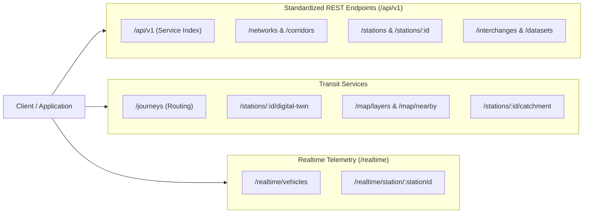

# TransitOS — Developer API Reference

## API Principles & Architecture

TransitOS provides versioned REST and streaming endpoints designed for transit application developers, transport researchers, and urban planning platforms.

* **Base URL (Production API Gateway)**: `https://transitos-33xk.onrender.com/api/v1`
* **Interactive Documentation (Swagger / OpenAPI)**: `https://transitos-33xk.onrender.com/docs`
* **System Health Check**: `https://transitos-33xk.onrender.com/health`
* **OpenAPI Schema (JSON)**: `https://transitos-33xk.onrender.com/api-json`
* **Format**: JSON (UTF-8) for REST queries; Protocol Buffers (`application/x-protobuf`) for GTFS-RT feeds.
* **Authentication**: Open public tiers for research and development; API keys for high-volume commercial consumers.

---

## Endpoint Catalog

---

### 1. Transit Data Infrastructure Endpoints (`/api/v1`)

#### `GET /api/v1`
TransitOS API Gateway Root & Service Discovery Index.
* **Description**: Returns the active API gateway version, health status, documentation links, and registered endpoint catalogue.

#### `GET /api/v1/networks`
Discover transit networks and operating systems.
* **Description**: Returns all active transit systems with operating metadata, geographic bounding boxes, line counts, and data trust tiers.

#### `GET /api/v1/corridors`
Retrieve transit corridors, lines, codes, and operational metadata.
* **Query Parameters**: `systemId` (UUID, optional).
* **Response**: Corridors with brand hex colors, operator agency names, operational status, route length, and station sequences.

#### `GET /api/v1/stations`
Query stations across networks with spatial and corridor filtering.
* **Query Parameters**: `lineId` (UUID, optional), `corridor` (string, optional), `bounds` (`minLng,minLat,maxLng,maxLat`, optional).
* **Response**: List of stations with geographic coordinates, wheelchair accessibility, line memberships, and entrance counts.

#### `GET /api/v1/stations/:id`
Retrieve detailed station infrastructure.
* **Path Parameters**: `id` (Station UUID or station code e.g. `STN_L1_003`).
* **Response**: Station profile including verified street entrances, boarding platforms, vertical levels, and interchange affiliations.

#### `GET /api/v1/interchanges`
Inspect physical multi-line interchange hubs and transfer corridors.
* **Response**: Multi-agency interchange complexes (e.g. Western Express Highway L1 ↔ Gundavali L7, D.N. Nagar L1 ↔ Andheri West L2A, Dadar central hub) with physical walkway links, elevated FOB geometries, and transfer impedances.

#### `GET /api/v1/datasets`
Discover registered transit datasets, versions, and governance lineage.
* **Response**: Regional dataset catalogue with provenance trust tiers (P0/P1), GTFS version tags, license terms, and validator compliance status.

---

### 2. Station Digital Twin & Micro-Topology

#### `GET /stations/:id/digital-twin`
Comprehensive multi-level indoor digital twin for a station complex.
* **Response**:
  * Vertical `levels` (Street Level 0, Concourse Level 1, Platform Level 2)
  * Boarding `platforms` with track alignments
  * Street `entrances` with verified gate codes, GPS coordinates, lift/escalator attributes
  * Internal `amenities` (elevators, restrooms, ticket counters, drinking water, ATMs)
  * `walkingEdges` mapping internal pedestrian connectivity across levels

---

### 3. Multi-Modal Journey & Routing Engine

#### `GET /journeys`
Generate top-$K$ Pareto-optimal multi-modal travel itineraries between stations.
* **Query Parameters**:
  * `from`: Origin station UUID
  * `to`: Destination station UUID
  * `k`: Number of candidate routes (1–10, default 5)
* **Algorithm**: Yen's $K$-shortest loopless paths with candidate filtering (feasibility + dominance) and multi-attribute tradeoff scoring.
* **Response**: Ranked itinerary candidates including in-vehicle travel time, transfer walking duration through specific station gates and FOBs, fare breakdown, and GeoJSON line-strings for map rendering.

---

### 4. Geospatial & Catchment Analytics

#### `GET /map/layers`
Retrieve ready-to-render GeoJSON layers for MapLibre/Mapbox GL map applications.
* **Layers**: `lines`, `stations`, `entrances`, `interchange-corridors`, `pedestrian-sidewalks`.

#### `GET /stations/:id/catchment`
Calculate pedestrian travel-time catchments along the physical walkable street network.
* **Query Parameters**: `minutes` (5, 10, 15), `speed` (walking speed in m/s, default 1.2).
* **Response**: GeoJSON Polygons representing realistic accessible urban catchment along real streets and sidewalks, accounting for urban severance barriers.

---

### 5. Real-Time Telemetry & GTFS-Realtime (GTFS-RT)

| Endpoint | Method | Entity Type | Description |
| :--- | :---: | :--- | :--- |
| `/realtime/vehicles` | `GET` | `VehiclePositions` | Live vehicle fleet positions, speed, bearing, current stop status (`IN_TRANSIT_TO`, `ARRIVED_AT`), and delay seconds. Query by `?system=MM&line=LINE1`. |
| `/realtime/station/:stationId` | `GET` | `TripUpdates` | Live platform countdown boards with incoming train ETAs (`etaMinutes`), destination headsigns, and coach layout. |
| `/health` | `GET` | System Health | API instance status, database connection, and Redis cache health. |
