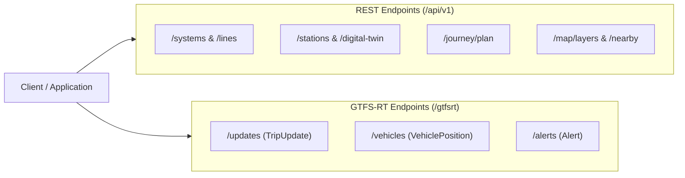

# TransitOS — Developer API Reference

## API Principles & Architecture

TransitOS provides versioned REST and streaming endpoints designed for transit application developers, transport researchers, and urban planning platforms.

* **Base URL (Production)**: `https://transitos-33xk.onrender.com/api/v1`
* **Realtime Feeds (Protobuf)**: `https://transitos-33xk.onrender.com/gtfsrt`
* **Format**: JSON (UTF-8) for REST queries; Protocol Buffers (`application/x-protobuf`) for GTFS-RT feeds.
* **Authentication**: Open public tiers for research and development; API keys for high-volume commercial consumers.

---

## Endpoint Catalog



---

### 1. Network & Infrastructure Endpoints

#### `GET /api/v1/systems`
List all active transit systems and metropolitan administrative areas.
* **Response**: List of systems with bounding boxes and supported transport modes.

#### `GET /api/v1/lines`
Retrieve lines and corridors for a given transit system.
* **Query Parameters**: `systemId` (UUID, optional).
* **Response**: Line metadata including brand color, operator agency, route length, and station count.

#### `GET /api/v1/stations`
Query stations across networks with spatial filtering.
* **Query Parameters**: `lineId`, `bounds` (minLng,minLat,maxLng,maxLat).
* **Response**: GeoJSON FeatureCollection of station centroids and basic attributes.

#### `GET /api/v1/stations/:id/digital-twin`
Retrieve the comprehensive internal digital twin for a station complex.
* **Response**:
  * Vertical `levels` (-2, -1, 0, 1, 2)
  * Boarding `platforms`
  * Street `entrances` with gate codes and accessibility status
  * Internal `amenities` (elevators, restrooms, ticket counters)
  * `walkingEdges` mapping internal pedestrian connectivity

---

### 2. Multi-Modal Journey & Routing Endpoints

#### `POST /api/v1/journey/plan`
Compute optimal multi-modal travel itineraries between two coordinates.
* **Request Body**:
  ```json
  {
    "origin": { "lat": 19.1197, "lng": 72.8468 },
    "destination": { "lat": 18.9306, "lng": 72.8261 },
    "time": "2026-10-31T08:30:00Z",
    "modePreferences": ["METRO", "WALK", "SUBURBAN_RAIL"],
    "wheelchairAccessible": false,
    "maxTransfers": 2
  }
  ```
* **Response**: Detailed itinerary candidates including in-vehicle legs, transfer walking directions through specific station gates and FOBs, fare calculation, and interchange friction scores.

---

### 3. Geospatial & Catchment Endpoints

#### `GET /api/v1/map/layers`
Retrieve ready-to-render GeoJSON layers for MapLibre/Mapbox GL map applications.
* **Layers**: `lines`, `stations`, `entrances`, `interchange-corridors`, `pedestrian-sidewalks`.

#### `GET /api/v1/analytics/isochrone`
Calculate pedestrian travel-time catchments from any station entrance.
* **Query Parameters**: `stationId`, `gateCode`, `timeMinutes` (5, 10, 15).
* **Response**: GeoJSON Polygon representing reachable urban area along verified pedestrian sidewalks.

---

### 4. Streaming GTFS-Realtime Endpoints

| Endpoint | Entity Type | Update Interval | Description |
| :--- | :--- | :---: | :--- |
| `GET /gtfsrt/updates` | `FeedEntity.tripUpdate` | 15s | Live stop arrival/departure predictions and delays. |
| `GET /gtfsrt/vehicles` | `FeedEntity.vehicle` | 10s | Dynamic vehicle coordinates, headings, and current stop status. |
| `GET /gtfsrt/alerts` | `FeedEntity.alert` | 30s | Network service disruptions, elevator outages, and operational bulletins. |
