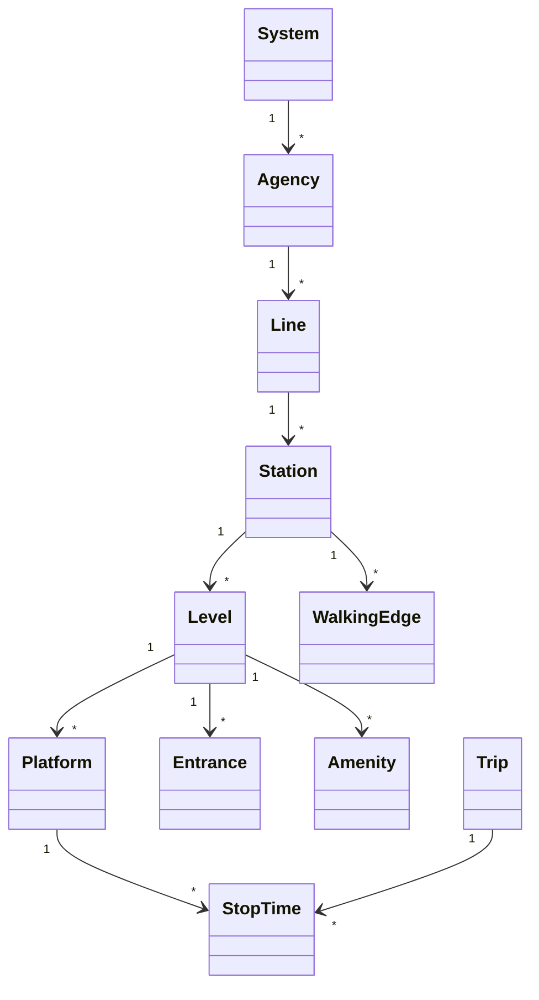

# Canonical Transit Model (CTM v1.0)

## Overview & Modeling Philosophy

The **Canonical Transit Model (CTM v1.0)** is TransitOS's authoritative relational schema implemented in PostgreSQL and PostGIS. 

Standard transit specifications (such as GTFS) primarily model networks for schedule publication rather than multi-layered physical infrastructure analysis. CTM extends standard transit modeling by decomposing stations into a strict spatial and topological hierarchy:



---

## Core Entities & Relational Hierarchy

### 1. Spatial Hierarchy Entities

#### `systems`
Top-level administrative or metropolitan grouping.
* Attributes: `id` (UUID), `code` (e.g., `MUMBAI_METRO`), `name`, `city` (e.g., `Mumbai`), `timezone`.

#### `agencies`
Operating corporations managing specific lines or concessions.
* Attributes: `id`, `code` (e.g., `MMMOCL`, `MMOPL`, `MMRCL`), `name`, `url`, `phone`, `systemId`.

#### `lines`
Physical or operational transit corridors.
* Attributes: `id`, `code` (e.g., `LINE1`, `LINE2A`, `LINE3`), `name`, `color` (Hex code), `textColor`, `mode` (`METRO`, `MONORAIL`, `SUBURBAN_RAIL`), `agencyId`.

#### `stations`
Parent station complex grouping all internal elements.
* Attributes: `id`, `code` (e.g., `STN_L3_025`), `name`, `latitude`, `longitude`, `geom` (`Geometry(Point, 4326)`), `wheelchairBoarding`, `systemId`.

#### `levels`
Vertical storeys within a station structure.
* Attributes: `id`, `code` (e.g., `LVL_STN_L3_025_G`, `LVL_STN_L3_025_C`, `LVL_STN_L3_025_P`), `stationId`, `index` (-2, -1, 0, 1, 2), `name` (`Street`, `Concourse`, `Platform`).

#### `platforms`
Specific tracks and boarding edges where trains stop.
* Attributes: `id`, `code` (e.g., `PF_STN_L3_025_1`), `name`, `stationId`, `levelId`, `platformCode` ("1", "2"), `latitude`, `longitude`, `geom`, `wheelchairBoarding`.

#### `entrances`
Physical street gates, portals, and direct landmark access points.
* Attributes: `id`, `code` (e.g., `ENT_STN_L3_025_A1`), `name`, `stationId`, `levelId`, `latitude`, `longitude`, `geom`, `accessible` (Boolean), `lift` (Boolean), `escalator` (Boolean), `snappedPedestrianEdgeId`.

#### `amenities`
Passenger facilities inside the station envelope.
* Attributes: `id`, `stationId`, `levelId`, `type` (`TICKET_COUNTER`, `TVM`, `RESTROOM`, `FIRST_AID`, `SECURITY_CHECK`), `latitude`, `longitude`, `geom`.

---

## The Station Walking Graph (`WalkingEdge`)

To evaluate realistic commuter movement and transfer friction, CTM models intra-station connectivity as explicit directed walking edges:

```sql
CREATE TABLE walking_edges (
    id UUID PRIMARY KEY DEFAULT gen_random_uuid(),
    station_id UUID REFERENCES stations(id),
    from_node_id VARCHAR(64) NOT NULL,
    to_node_id VARCHAR(64) NOT NULL,
    edge_type VARCHAR(32) NOT NULL, -- 'STAIRS', 'ESCALATOR', 'ELEVATOR', 'CORRIDOR', 'AFC_GATE'
    length_meters NUMERIC(6,2) NOT NULL,
    traversal_seconds NUMERIC(6,2) NOT NULL,
    is_bidirectional BOOLEAN DEFAULT TRUE,
    level_change INTEGER DEFAULT 0, -- delta Z (-1 for down, +1 for up)
    signposted_as VARCHAR(255),
    reversed_signposted_as VARCHAR(255)
);
```

### Edge Types & Physical Impedance
1. **`CORRIDOR`**: Horizontal walking walkways (assumed $1.2\text{ m/s}$).
2. **`STAIRS`**: Vertical pedestrian steps requiring elevated energy expenditure (impedance weight $w_z = 2.5$).
3. **`ESCALATOR`**: Mechanized passenger transport ($0.6\text{ m/s}$ mechanical speed).
4. **`ELEVATOR`**: Step-free accessible vertical lifts (including door open/close cycle delays).
5. **`AFC_GATE`**: Automated fare collection turnstiles (smart card tap / QR ticket barrier with queuing penalty).

---

## Timetable & Operational Entities

* **`trips`**: Individual scheduled train dispatches tied to a `route_id`, `service_id` (calendar pattern), `trip_headsign`, `direction_id`, and `shape_id`.
* **`stop_times`**: Ordered sequence of station platform arrivals and departures with second-level precision:
  $$\text{Dwell Time} = t_{\text{departure}} - t_{\text{arrival}}$$
* **`shapes`**: High-resolution linestring geometry representing the physical track alignment in PostGIS (`Geometry(LineString, 4326)`).
* **`calendars` / `calendar_dates`**: Weekly operating patterns (`SVC_WEEKDAY`, `SVC_SATURDAY`, `SVC_SUNDAY`) and holiday exceptions.

---

## Synchronized GTFS Export Integration

CTM acts as the upstream source for canonical GTFS exports via [`scripts/export_synchronized_gtfs.js`](file:///c:/Users/HP/OneDrive/Desktop/MetroRadar/scripts/export_synchronized_gtfs.js):
* `stations` $\rightarrow$ `stops.txt` (`location_type = 1`)
* `platforms` $\rightarrow$ `stops.txt` (`location_type = 0`, with `parent_station`)
* `entrances` $\rightarrow$ `stops.txt` (`location_type = 2`, with `parent_station`)
* `concourse nodes` $\rightarrow$ `stops.txt` (`location_type = 3`, with `parent_station`)
* `walking_edges` $\rightarrow$ `pathways.txt` (with explicit modes, lengths, traversal times, and wheelchair compatibility)
* `levels` $\rightarrow$ `levels.txt`
