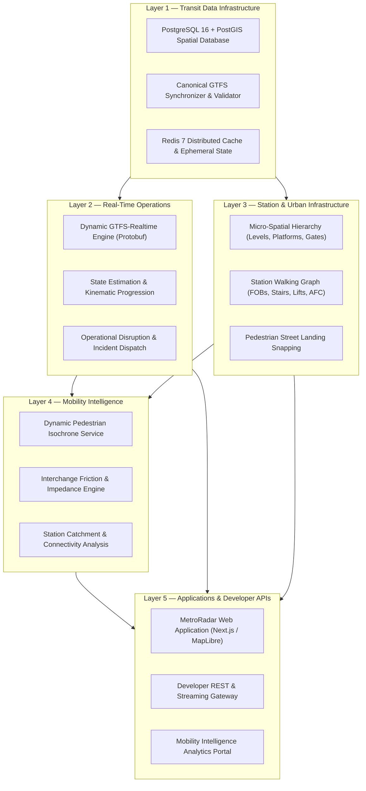

# TransitOS — Platform Architecture

## System Overview & The Five-Layer Stack

TransitOS is architected around five cleanly separated, modular tiers. Each layer possesses a distinct ownership boundary and exposes standardized interfaces to the layers above.

---

## Technical Stack & Infrastructure Components

| Subsystem | Technology | Purpose |
| :--- | :--- | :--- |
| **Spatial Database** | PostgreSQL 16 + PostGIS 3.4 | Primary relational data store with GIST spatial indexing, geography types, and trigger-based geometry synchronization. |
| **Data Access Layer** | Prisma ORM | Type-safe query builder, migration manager, and schema relational mapping. |
| **Cache & State Store** | Redis 7 | In-memory storage for serialized multigraph instances, station cache, and live vehicle positions. |
| **Backend Gateway** | NestJS 11 (Node.js 22 LTS) | Modular microservices, REST endpoints, dependency injection, and data validation pipelines. |
| **Pathfinding Engine** | Time-Dependent Directed Multigraph + OTP 2.x | High-performance graph routing evaluating revenue transit segments, foot overbridges, and vertical level ascents. |
| **Realtime Feeds** | Protocol Buffers (gtfs-realtime-bindings) | Dynamic GTFS-RT feed generation providing `/gtfsrt/updates`, `/gtfsrt/vehicles`, and `/gtfsrt/alerts`. |
| **Frontend Application** | Next.js 16 + React 19 + Turbopack | Server-side rendered commuter interface with MapLibre GL, Tailwind CSS, and shadcn/ui components. |
| **Spatial GIS Engine** | MapLibre GL + Turf.js | Client-side vector tile rendering, dynamic layer styling, and geospatial buffer/polygon calculations. |

---

## Detailed Layer Breakdown

### Layer 1: Transit Data Infrastructure
* **Role**: Serves as the authoritative source of truth for all planned transit networks.
* **Storage**: Maintains tables for `systems`, `agencies`, `lines`, `stations`, `levels`, `platforms`, `entrances`, `amenities`, `trips`, `stop_times`, `shapes`, and `calendars`.
* **Validation**: Implements automated referential integrity checks (e.g., stops must belong to parent stations; pathways must link valid stops; schedules must form complete circuits).

### Layer 2: Real-Time Operations
* **Role**: Computes and streams live operational state across all lines and rolling stock.
* **Architecture**: Ephemeral in-memory calculations prevent database bloat. Timetables are matched against the live clock (IST) to evaluate vehicle locations along 3D line shapes, calculating dynamic headway and stop delays.
* **Protobuf Delivery**: Serializes real-time entity updates into standard GTFS-RT Protobuf streams (`FeedMessage`) consumed by passenger apps and third-party consumers.

### Layer 3: Station & Urban Infrastructure
* **Role**: Models the physical environment inside stations and at street interfaces.
* **Components**:
  * **Levels**: Categorizes stations by vertical levels (`Street/Ground`, `Concourse`, `Mezzanine`, `Platform`).
  * **Gates & Entrances**: Georeferenced street entrances snapped to pedestrian sidewalk networks with accessibility flags (wheelchair, lift, escalator).
  * **Walking Graph**: Directed graph edges representing horizontal corridors, vertical stairways, escalators, elevators, and automated fare collection (AFC) turnstiles.

### Layer 4: Mobility Intelligence
* **Role**: Analytical computational engine evaluating passenger impedance and network connectivity.
* **Calculations**:
  * **Generalized Cost Scoring**: Integrates in-vehicle time, wait time, fare structure, and transfer friction.
  * **Interchange Friction ($\Delta Z$)**: Penalizes transfers requiring multi-level vertical transitions or extensive cross-concourse walking.
  * **Catchment Isochrones**: Computes 5, 10, and 15-minute walking polygons from any station gate along surveyed pedestrian paths.

### Layer 5: Applications & APIs
* **Role**: Public-facing consumer and developer touchpoints.
* **Deliverables**:
  * Responsive Web App (`metro-radar-blush.vercel.app`).
  * Public REST endpoints for network inspection, digital twins, and journey itineraries.
  * Static GTFS export archives (`mumbai_discrete_ready.zip`) and streaming RT feeds.
