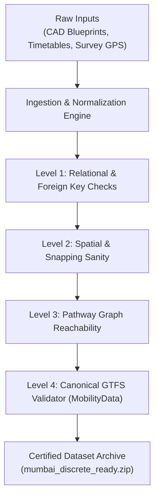

# TransitOS — Data Quality & Validation Architecture

## Overview & Quality Principles

A core principle of TransitOS is that **data infrastructure is only as valuable as its verifiable quality and provenance**.

Traditional transit data pipelines often suffer from:
* Orphan stops without parent station relationships or schedule associations.
* Disconnected platforms and concourses with broken pathway topology (`pathway_unreachable_location`).
* Entrances snapped unrealistically onto building rooftops or un-walkable highway medians.
* Static schedule feeds with non-standard headway interpolations.

TransitOS establishes a multi-tiered validation pipeline guaranteeing 100% referential integrity and strict conformance with international standards before any dataset is exported or served via API.

---

## Validation Pipeline Architecture

---

## The Four Validation Levels

### Level 1: Relational Referential Integrity
* **Parent Station Constraint**: Every platform (`location_type=0`), entrance (`location_type=2`), and concourse node (`location_type=3`) must reference an active, valid parent station (`location_type=1`).
* **Foreign Key Verification**: All `stop_times` rows must link to a valid `trip_id` and `stop_id`.
* **Zero Orphan Stops**: Unconnected transit stops or obsolete gate iterations are safely detected and purged during synchronization.

### Level 2: Spatial & Snapping Sanity
* **Coordinate Bounds**: All entities must fall strictly within the defined geographic bounding polygon of the metropolitan area (e.g. Mumbai bounding box: `[18.85, 72.75]` to `[19.35, 73.05]`).
* **Sidewalk Snapping Verification**: Entrances must be snapped cleanly to navigable street sidewalks. Distance from the physical gate threshold to the nearest pedestrian network edge must be strictly bounded ($< 30\text{ m}$), eliminating "rooftop" snapping errors.
* **Elevation Ordering**: Multi-level stations must maintain consistent vertical indices ($Z_{\text{Platform}} < Z_{\text{Concourse}} < Z_{\text{Street}}$ for underground; $Z_{\text{Street}} < Z_{\text{Concourse}} < Z_{\text{Platform}}$ for elevated).

### Level 3: Station Pathway Graph Reachability
* Evaluates intra-station directed connectivity as formalized by the MobilityData validator:
  $$\forall v \in \{V_{\text{platform}} \cup V_{\text{concourse}}\}, \quad \exists \text{ path}(V_{\text{entrance}} \to v) \land \exists \text{ path}(v \to V_{\text{exit}})$$
* **Bidirectional Checks**: Validates that turnstiles (AFC) enforce one-way entry/exit directionality (`is_bidirectional = 0`), while stairs, escalators, and elevators provide full return paths.
* **Zero Unreachable Locations**: Guarantees that no commuter can arrive at a platform without a legal egress path to the street, and vice versa.

### Level 4: Canonical MobilityData GTFS Conformance
* Automated CI verification utilizing the [Canonical GTFS Schedule Validator](https://github.com/MobilityData/gtfs-validator).
* Ensures zero validation errors across:
  * `pathway_unreachable_location` (0 errors)
  * `invalid_currency` / `fare_rules` (0 errors)
  * `feed_info_start_date` and `service_window` alignment.
