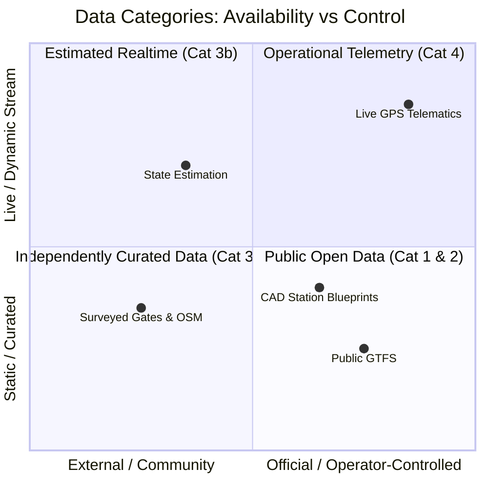

# TransitOS — Data Provenance, Licensing & Trust Framework

## The Four Data Categories

Transit data exists along a spectrum of availability, authorization, and operational reliability. Following the precedent established by the Delhi Transport Stack, TransitOS explicitly categorizes all underlying datasets into four distinct tiers:



---

### Category 1: Public Open Data
* **Definition**: Data officially published by transit agencies or government portals under an open license (e.g., Creative Commons, Open Government Data License).
* **Examples**: Published route names, fare tables, operating hours, high-level line maps.
* **Usage**: Freely ingestible and distributable with standard attribution.

### Category 2: Restricted / Approval-Based Data
* **Definition**: Data held by transit agencies that requires formal registration, data-sharing agreements, or developer API key approval.
* **Examples**: High-frequency bus GPS streams, internal ticketing passenger counts, detailed station technical documentation.
* **Usage**: Ingested only when explicit authorization is granted; access boundaries are respected in all downstream APIs.

### Category 3: Independently Curated & Ground-Truthed Data
* **Definition**: Data constructed, surveyed, or synthesized by the TransitOS team and open-source contributors from verifiable public sources (e.g., Detailed Project Reports [DPRs], satellite imagery, on-site physical surveys, OpenStreetMap).
* **Examples**: Exact station gate coordinates, pedestrian foot overbridge (FOB) connections, elevator and escalator locations, discrete timetable synthesis.
* **Usage**: Maintained under an open MIT / ODbL framework with transparent derivation methodologies.

### Category 4: Operational Telematics & System Data
* **Definition**: Live machine-generated streams produced by rolling stock telemetry, automatic vehicle location (AVL) transponders, and automated fare gates.
* **Examples**: Real-time train location pings, door opening signals, live passenger load sensors.
* **Usage**: Where direct feeds do not yet exist, TransitOS generates **Level 3 State-Estimated feeds** powered by kinematic physics and discrete timetables, clearly labeled as estimated rather than official operator telemetry.

---

## Dataset Metadata & Provenance Schema

Every entity and dataset in TransitOS carries authoritative metadata documenting its lineage and confidence score:

```json
{
  "datasetId": "mumbai-metro-line3-entrances",
  "name": "Mumbai Metro Line 3 Verified Gate Coordinates",
  "category": "INDEPENDENTLY_CURATED",
  "source": {
    "organization": "MMRCL Official Wayfinder + On-ground Verification",
    "documentUri": "https://mmrcl.com/passenger-information/station-facilities",
    "verificationMethod": "FIELD_SURVEY_AND_OSM_CROSS_VERIFICATION"
  },
  "confidenceScore": 0.98,
  "license": "ODbL-1.0",
  "lastVerified": "2026-10-30T18:00:00Z",
  "geographicBounds": {
    "southWest": [18.912, 72.819],
    "northEast": [19.131, 72.885]
  },
  "limitations": [
    "Underground station layout depths estimated from JICA DPR engineering sections; horizontal coordinates ground-truthed."
  ]
}
```

---

## Confidence Scoring Methodology

TransitOS scores all datasets on a standard 0.00 to 1.00 confidence scale:

* **0.95 – 1.00 (Gold Standard)**: Officially published or physically surveyed and cross-verified against high-resolution imagery and ground truth.
* **0.80 – 0.94 (Silver Standard)**: Derived from authoritative technical documents (e.g. approved DPR engineering plans) with slight temporal variance.
* **0.60 – 0.79 (Bronze / Estimated)**: Algorithmic estimation, kinematic progression, or community-reported data.
* **< 0.60 (Experimental)**: Unverified exploratory data; flagged and excluded from passenger routing itineraries.
