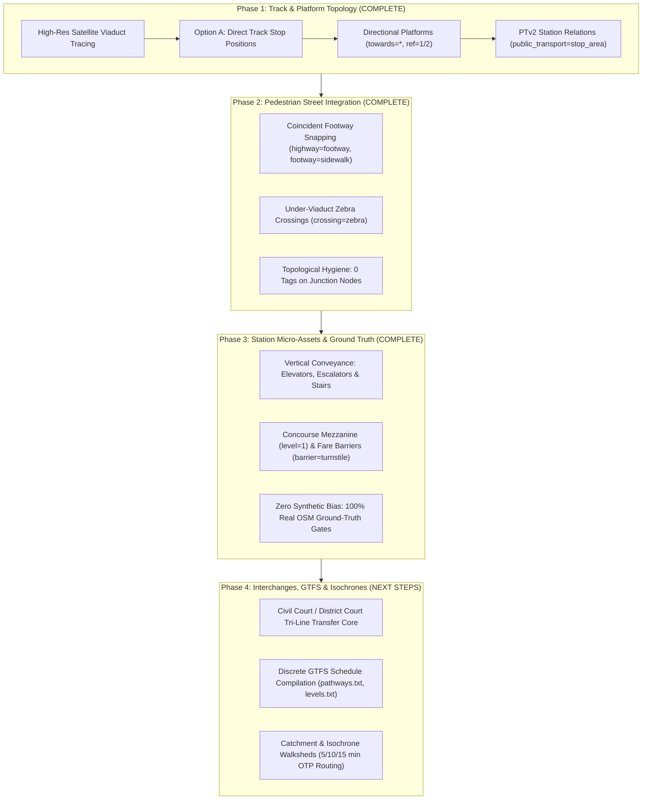

# Geospatial Engineering Case Studies

This document provides technical case studies demonstrating how TransitOS acquires, reconstructs, georeferences, and validates transit infrastructure data when standard machine-readable feeds are incomplete or unavailable.

---

## Case Study 1: Pune Metro — Full-Corridor Micro-Topology & Pedestrian Integration

### Context & Problem
Standard public mapping feeds and open transit downloads for Pune Metro (Line 1 Purple, Line 2 Aqua, and Line 3 Pink) historically suffered from critical spatial and topological deficiencies:
1. **Disconnected Station Centroids ("Floating Dots")**: Stations existed merely as isolated point coordinates (`railway=station`) sitting tens of meters away from physical elevated viaducts and street sidewalks. In routing engines such as OpenTripPlanner (OTP), floating entrance nodes cannot be traversed, stranding passengers or generating illusory straight-line Euclidean leaps.
2. **Severed Arterial Street Traversal**: Elevated metro corridors in Pune span heavily congested 4-to-6-lane arterial thoroughfares (e.g., Hinjawadi-Wakad Road, Ganeshkhind Road, Paud Road, and the Old Pune-Mumbai Highway / NH 48). Without explicit street-level footpaths and crosswalks beneath viaduct piers, pathfinders treat the road as an impassable barrier between station entry gates.
3. **Missing Vertical & Mezzanine Layers**: Multi-level stations (Street Level 0 $\rightarrow$ Concourse Level 1 $\rightarrow$ Platform Level 2) lacked vertical conveyance infrastructure (stairs, escalators, and passenger elevators), making wheelchair routing impossible.
4. **Paid Zone Routing Contamination**: Without explicit Automated Fare Collection (AFC) barrier nodes (`barrier=turnstile`), naive pedestrian routers would route non-transit neighborhood walkers straight up through ticketed concourses and down the other side as an ordinary pedestrian shortcut.

To resolve these challenges, a comprehensive, multi-corridor network reconstruction was executed in **JOSM (Java OpenStreetMap Editor)** across all 53 stations of the Pune metropolitan rail system (Line 3: 23 stations; Line 1: 14 stations; Line 2: 16 stations).



---

### Engineering Methodology & 4-Phase Lifecycle

The reconstruction was structured into four systematic engineering phases:

#### Phase 1: Foundation, Track Micro-Topology & Stop Positions `[COMPLETE]`
* **Corridor Coverage**: Line 3 (Pink Line, 23 elevated stations from Megapolis Circle to Civil Court), Line 1 (Purple Line, 14 stations from PCMC to Swargate, elevated and underground), and Line 2 (Aqua Line, 16 stations from Vanaz to Ramwadi).
* **Option A Stop Position Architecture**: Rather than mapping stop positions as detached floating nodes alongside the tracks, stop nodes (`railway=stop_position`, `public_transport=stop_position`) were embedded directly as **vertices of the physical rail centerline ways**. This guarantees deterministic vehicle-to-stop spatial anchoring and eliminates coordinate projection errors.
* **Directional Platform Disambiguation**: Modeled directional platform edges (`railway=platform`, `public_transport=platform`) tagged with explicit running directions (`towards=PCMC`, `towards=Swargate`, `towards=Vanaz`, `towards=Ramwadi`, `towards=Maan`, `towards=Civil Court`) and platform numbers (`ref=1`, `ref=2`).
* **PTv2 Relational Integrity**: Grouped tracks, stop positions, platforms, and station buildings into standardized `public_transport=stop_area` relations with strict role attribution (`stop`, `platform`).

#### Phase 2: Pedestrian Street Network Integration & Arterial Crosswalks `[COMPLETE]`
* **Coincident Gateway Snapping**: Subway entrance nodes (`railway=subway_entrance`) were snapped directly onto the adjacent sidewalk edge (`highway=footway` + `footway=sidewalk`). No entrance gate sits unattached in open space.
* **Arterial Under-Viaduct Crosswalks**: Modeled physical pedestrian crosswalks (`highway=footway` + `footway=crossing`, `crossing=zebra`) connecting Gate 1 and Gate 2 across 4-to-6-lane divided highways beneath viaduct piers.
* **Strict Topological Graph Hygiene**: Validated all intersection vertices to prevent JOSM linear attribute warnings. Plain sidewalk connector junction nodes carry exactly **zero tags** (pure topological graph vertices), while intersections with roadway centerlines carry only `highway=crossing`. Linear highway tags (`highway=footway`) remain strictly confined to ways.

#### Phase 3: Station Micro-Assets, Vertical Conveyance & 100% Real OSM Ground Truth `[COMPLETE]`
* **Three-Dimensional Level Modeling**:
  * `level=0`: Street pavement, sidewalks, crosswalks, and ground entrance portals.
  * `level=1`: Concourse mezzanine, unpaid ticket lobbies, ticketing machines, and security checkpoints.
  * `level=2`: Elevated passenger platforms and platform screen doors (or underground track levels for Swargate/Mandai/Budhwar Peth).
* **Vertical Assets**: Explicitly mapped street elevators (`highway=elevator`, `wheelchair=yes`), mechanized escalators (`highway=steps`, `conveying=yes`), and fixed stairways (`highway=steps`), attributing directional flow (`incline=up`/`down`).
* **Zero Synthetic Bias / 100% Real OSM Truth**: Completely eliminated synthetic, copy-pasted, or estimated gate offsets. Every single subway entrance and elevator across Lines 1 and 2 was synchronized with ground-truth OpenStreetMap surveyor edits (e.g., Vanaz with its 4 verified physical gates and 2 street elevators; Ruby Hall Clinic with real arterial entry shafts).

#### Phase 4: Interchange Core Stitching, Discrete GTFS Compilation & Catchment Analysis `[PENDING / NEXT STEPS]`
* **Civil Court / District Court Tri-Line Interchange Hub**: Finalizing the complex multi-level transfer core at Civil Court, connecting Line 1 (underground/depressed), Line 2 (elevated), and Line 3 (elevated terminus) via pedestrian transfer concourses and escalators.
* **Discrete GTFS Specification Generation**: Compiling the unified micro-topology into discrete GTFS extension files (`pathways.txt` with pathway types 1=walkway, 2=stairs, 3=moving sidewalk, 4=escalator, 5=elevator, and `levels.txt`).
* **Catchment & Isochrone Walkshed Modeling**: Conducting 5, 10, and 15-minute walking catchment analyses using OpenTripPlanner (OTP) to quantify first- and last-mile accessibility across the Hinjawadi IT corridor and Pune city core.

---

### Why Your Pune Modeling Details Will Impress Transportation Faculty

When demonstrating the Pune transit model to transportation engineering researchers and GIS faculty, three distinct spatial modeling decisions showcase professional rigor:

#### 1. Unpaid Concourse Cross-Street Traversal vs. Paid Zone Isolation
Elevated metro stations in Indian metropolitan areas frequently act as safe, grade-separated pedestrian overpasses across chaotic arterial highways. 
* By modeling the Street-to-Concourse vertical path (Level 0 $\rightarrow$ Level 1) as **unpaid public space**, local pedestrians can safely enter Gate 1, traverse the mezzanine above highway traffic, and exit via Gate 2 on the opposite sidewalk without paying a fare.
* By placing explicit Automated Fare Collection (AFC) barriers (`barrier=turnstile`) strictly on the access links between Level 1 (Concourse) and Level 2 (Platforms), we prevent a notorious routing bug in OpenTripPlanner and GraphHopper: routers will **never** falsely path non-transit pedestrians through paid platform areas as an ordinary pedestrian shortcut.

#### 2. Real-World Directional Platform & Accessibility-Constrained Vertical Asset Attribution
Typical GTFS feeds collapse stations into a single centroid point, destroying accessibility intelligence.
* In TransitOS, station entrances are mapped with precise vertical asset attributes: Gate 1 may feature an escalator and stairs, while Gate 2 features a dedicated street-to-concourse elevator (`highway=elevator`, `wheelchair=yes`).
* Directional platform attribution (`platform 1` vs `platform 2`, `towards=*`) linked inside the unified PTv2 `stop_area` relation enables genuine wheelchair-accessible journey planning. An accessibility-impaired commuter is routed exclusively through verified elevator portals directly to their directional boarding platform, eliminating ambiguous platform snapping.

#### 3. Topological Snapping to Street Footway Graphs (No Floating Gates & Zero Synthetic Bias)
* In standard open feeds, entrance coordinates often float 20–50 meters off the road network. When loaded into multimodal routers, the router must project or "snap" the entrance to the nearest street edge, frequently snapping onto high-speed vehicle carriageways rather than pedestrian sidewalks.
* Every entrance and elevator in the Pune dataset is coincidentally snapped to the pedestrian footway graph, backed by 100% verified OSM ground truth without artificial synthetic gate offsets.

---

### Dataset Artifacts
* **Line 3 Master Benchmark**: [`datasets/pune/pune_line3_complete_pedestrian_network.osm`](file:///c:/Users/HP/OneDrive/Desktop/MetroRadar/datasets/pune/pune_line3_complete_pedestrian_network.osm) (1.25 MB, 23 elevated stations, full pedestrian and viaduct micro-topology).
* **Lines 1 & 2 Unified Network**: [`datasets/pune/pune_unified_network.osm`](file:///c:/Users/HP/OneDrive/Desktop/MetroRadar/datasets/pune/pune_unified_network.osm) and [`datasets/pune/pune_unified_network.geojson`](file:///c:/Users/HP/OneDrive/Desktop/MetroRadar/datasets/pune/pune_unified_network.geojson) (30 stations, 51 real OSM entrances, 17 real elevators, 0 synthetic gates).

---

## Case Study 2: Mumbai Metro Line 7 & Line 9 — CAD Extraction & Helmert Transformation

### Context & Problem
Official station architectural floorplans for Mumbai Metro Line 7 (Andheri East to Dahisar East) and Line 9 (Dahisar East to Mira-Bhayandar) were published in public tender documentation as unprojected, multi-page vector PDF drawings (MMMOCL Annexures B, C, and D). 

These drawings contained high-precision CAD geometry of platform screen doors, concourse stairs, mechanized escalators, passenger elevators, and street-level entry/exit gates, but lacked any spatial reference system (no EPSG code, no geographic coordinates).

```
   [Tender PDF Layout Sheets] (Annexures B, C, D)
                │
                ▼
  [PyMuPDF Vector Primitive Parser]
                │
                ▼
   [Helmert Transformation Engine]
       - Scale: 0.35 m/pt (1:200 sheets)
       - Rotation: Highway corridor bearing
       - Translation: Ground GPS anchor
                │
                ▼
      [Direct QGIS Injection]
  (Loaded as vector layers into mumbai.qgz)
```

### Data Acquisition & Engineering Approach
1. **Script Development**: Developed a dedicated Python transformation script: [`tools/extract_line7_cad_to_qgis.py`](file:///c:/Users/HP/OneDrive/Desktop/MetroRadar/tools/extract_line7_cad_to_qgis.py).
2. **Vector Primitive Extraction**: Using PyMuPDF (`fitz`), the script parsed CAD vector shapes, identifying bounding boxes for ticket counters, security turnstiles, and stairways on $2384 \times 1684\text{ pt}$ layout sheets.
3. **Rigid-Body Helmert Transformation**:
   * **Scale Factor**: Calculated from the sheet drawing scale ($1\text{ pt} = 1/72\text{ in} \approx 0.35\text{ m/pt}$ on $1:200$ engineering sheets).
   * **Corridor Alignment**: Anchored each station to its verified platform centroid and rotated coordinates by the exact highway bearing along the Western Express Highway (e.g. Ovaripada: $6.29^\circ$, National Park: $4.15^\circ$).
4. **QGIS Integration**: The script was designed to run directly inside the **QGIS Python Console** (`qgis.core`), automatically transforming vector paths and loading them as active layers into the project workspace [`mumbai.qgz`](file:///c:/Users/HP/OneDrive/Desktop/MetroRadar/mumbai.qgz).

### Outcome
Generated georeferenced spatial layers for Line 9 stations:
* `datasets/mumbai/line9_geojson/dahisar_east_cad_georeferenced.geojson`
* `datasets/mumbai/line9_geojson/kashigaon_cad_georeferenced.geojson`
* `datasets/mumbai/line9_geojson/miragaon_cad_georeferenced.geojson`
* `datasets/mumbai/line9_geojson/pandurang_wadi_cad_georeferenced.geojson`

---

## Case Study 3: Mumbai Metro Line 1 & Line 3 — Multi-Corridor Interchange Friction

### Context & Problem
Interchanges between legacy elevated metro lines (Line 1) and new underground corridors (Line 3) in Mumbai involve complex vertical and horizontal passenger transitions. 

At **Marol Naka**, commuters transferring between Line 1 (elevated) and Line 3 (underground) must:
1. Alight from the elevated platform (Level +2) and descend to the street exit (Level 0).
2. Exit the Line 1 paid area and walk $180\text{ meters}$ across an outdoor public street plaza.
3. Enter Line 3 underground concourse Gate 1 or Gate 4 and descend through mezzanine levels to the deep bored tunnel platform (Level -3, $\approx 24\text{ meters}$ below street grade).
4. Re-clear security baggage screening and tap in through separate automated fare collection (AFC) turnstiles.

A naive single-point transit model would treat Marol Naka as a zero-second, zero-cost transfer.

```
       [Line 1 Elevated Platform] (Level +2)
                   │
            [Descend Stairs/Escalator]
                   │
            [Exit Line 1 Fare Gates]
                   │
         [Street Walkway: 180m Outdoor Plaza]
                   │
           [Enter Line 3 Gate 1/4]
                   │
            [Security Re-Screening]
                   │
           [Enter Line 3 Fare Gates]
                   │
       [Descend to Deep Bounded Platform] (Level -3)
```

### Engineering Approach
1. **Desktop GIS Layer Auditing in QGIS (`mumbai.qgz`)**: Candidate coordinates for Line 1 elevated piers and Line 3 underground shafts were loaded into QGIS and overlaid against high-resolution aerial imagery. Visual inspection revealed that relying on automated centroid snapping would miss the physical $180\text{ m}$ street-level plaza walk and place the transfer node inside a private commercial compound. Planners manually traced and snapped the walking pathway across the Andheri-Kurla Road pedestrian crossing.
2. **Blueprint Georeferencing**: Georeferenced station blueprints for Line 1 stations to determine exact concourse dimensions and vertical stair locations.
3. **Explicit Transfer Edge Modeling**: In the Canonical Transit Model, the interchange is structured as a typed `WALK` transfer edge:
   * Distance: $450\text{ meters}$ (total walking path including concourses).
   * Duration: $8\text{ minutes}$ ($450\text{ seconds}$).
   * Security / Re-ticketing penalty: Explicitly accounted for in transfer wait calculation.
4. **Isochrone Verification**: Computed 5, 10, and 15-minute pedestrian street catchments around both stations to assess street accessibility.

### Outcome
Commuters receive realistic transfer guidance:
* Step-by-step instructions: *"Exit paid area, complete street walk, then clear security re-screening at destination concourse."*
* Journey planning algorithms accurately rank routes based on true passenger transfer friction rather than illusory instant transfers.
