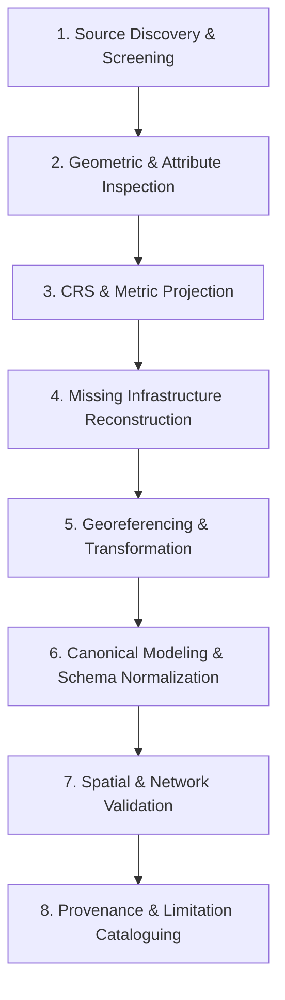

# Data Acquisition & Preparation Workflow

TransitOS does not assume that complete, machine-readable station and network models are available from a single authoritative source. Instead, the platform implements a structured, repeatable 8-stage data acquisition and preparation lifecycle designed to handle imperfect, multi-source, and heterogeneous urban transport data.

---

## The 8-Stage Spatial Data Lifecycle

### 1. Source Discovery & Screening
Identify available datasets across diverse tiers:
* **Tier 0 (Authoritative Feeds)**: Official schedules and alignment data published by transit authorities (e.g. MMMOCL, MMRDA, MMRCL, Maha Metro).
* **Tier 1 (Engineering & Tender Annexures)**: Detailed Project Reports (DPRs), architectural tender layout sheets, station kiosk plans, and contractor CAD drawings.
* **Tier 2 (Open Community Registries)**: OpenStreetMap planet dumps, Overpass API queries, and municipal open data portals.
* **Tier 3 (Field & Community Surveys)**: Ground-truthed entrance gate coordinates, photographic wayfinding audits, and elevator accessibility surveys.

Each source is logged with capture date, URL/origin, licensing terms, and geographical boundary.

### 2. Geometric & Attribute Inspection (Desktop GIS Staging)
Before any automated processing, candidate database coordinates and raw source files are loaded directly into **QGIS** for cartographic inspection against high-resolution satellite basemaps and georeferenced civil drawings:
* **Coverage Analysis**: Checking whether all revenue stations and active lines are present.
* **Attribute Consistency**: Confirming station naming variants across languages (English, Marathi, Hindi) and verifying operational line codes (e.g., Line 2A vs Line 7).
* **Topological Sanity**: Detecting self-intersecting polygons, disconnected line segments, and inverted coordinate pairs (e.g. latitude/longitude reversals).
* **Ground-Truth Cross-Check**: Visually identifying misplaced station points (e.g. centroids placed inside highway medians or private property) prior to automated processing.

### 3. Coordinate Reference System (CRS) Normalization
Geographic transit calculations require switching between angular spherical coordinates and metric Euclidean projections:
* **Storage & Exchange (EPSG:4326 / WGS84)**: Used for all API payloads, GeoJSON exports, and PostgreSQL database storage. Coordinates are represented as decimal degrees `(longitude, latitude)`.
* **Metric Calculation (EPSG:32643 / UTM Zone 43N)**: Applied when measuring physical distances, walking isochrones, buffer radiuses, and pedestrian walking network lengths in Mumbai and Pune.
* **CAD Local Space**: 2D Cartesian sheet coordinates (measured in PostScript points or millimeters) with an arbitrary local origin `(0, 0)`.

### 4. Desktop GIS Reconstruction & Micro-Topology (The 80% Work)
Programmatic algorithms can automate database storage, but **80% of spatial accuracy is won inside desktop GIS (QGIS and JOSM)** where transport planners manually reconstruct real-world urban access:
* **QGIS Cartographic Editing (`mumbai.qgz`)**:
  - Transport planners manually drag and snap entrance gates from arbitrary road centroids to physical sidewalk kerbs and Foot Overbridge (FOB) landing staircases.
  - Viaduct alignments are manually digitized to trace physical metro pier columns rather than adjacent vehicular flyovers.
  - Complex multi-level interchange complexes (such as Gundavali L7 $\leftrightarrow$ Western Express Highway L1 and D.N. Nagar L1 $\leftrightarrow$ Andheri West L2A) are unraveled in QGIS to reflect true vertical elevation drops and enclosed skywalk geometry.
* **JOSM Pedestrian Topology Auditing**:
  - OpenStreetMap street and pathway layers are loaded into the **Java OpenStreetMap Editor (JOSM)**.
  - Missing pedestrian crosswalks, sidewalk links, and station access ways are micro-mapped and snapped directly to station entrance nodes.
  - OpenStreetMap standard transit tags (`railway=subway_entrance`, `highway=footway`, `footway=crossing`, `level=*`, `tactile_paving=*`) are audited to ensure flawless routing graph traversability.

### 5. Georeferencing & Transformation
For architectural CAD drawings and station layout blueprints that lack spatial reference:
* Identifiable ground control points (GCPs)—such as station centerline piers, road median intersections, or highway flyover columns—are matched between the drawing and satellite basemaps.
* A Helmert (similarity) transformation is computed to translate, rotate, and uniformly scale drawing vectors into geographic coordinates.
* Transformation residuals and root-mean-square errors (RMSE) are recorded to quantify alignment confidence.

### 6. Canonical Modeling & Schema Normalization
Prepared spatial features are ingested into the **Canonical Transit Model (CTM)**:
* Stations are registered with unique stable IDs, official operational codes, English/vernacular names, and centroid coordinates.
* Station access points are structured as distinct `Gate` entities with ground-truthed GPS coordinates, directional tags, level designations, and street accessibility notes.
* Intra-station walking links (stairs, escalators, lifts, concourse passages) are compiled into typed pathway records.

### 7. Spatial & Network Validation
The compiled transit network is subjected to rigorous spatial and routing tests:
* **Coordinate Bounds Verification**: Ensures all points fall strictly within the defined metropolitan envelope (e.g., MMR boundary: `18.8°N - 19.5°N, 72.7°E - 73.2°E`).
* **GTFS Specification Conformance**: Verified against the Canonical MobilityData GTFS Validator to guarantee zero unreachable stops, zero loop pathways, and zero orphan platforms.
* **Graph Connectivity Auditing**: Validates that every platform is reachable from at least one entrance gate and that interchange transfers between intersecting corridors have valid pedestrian walking paths.

### 8. Provenance & Limitation Cataloguing
Finally, dataset metadata is recorded in the TransitOS catalogue:
* **Confidence Level**: Assigned based on source tier (Authoritative vs Curated vs Inferred).
* **Licensing Compliance**: Verifies that open database licenses (ODbL, CC-BY) or public record fair-use conditions are properly attributed.
* **Known Deficiencies**: Documents stations that currently rely on centroid approximations pending future on-site gate surveys.
