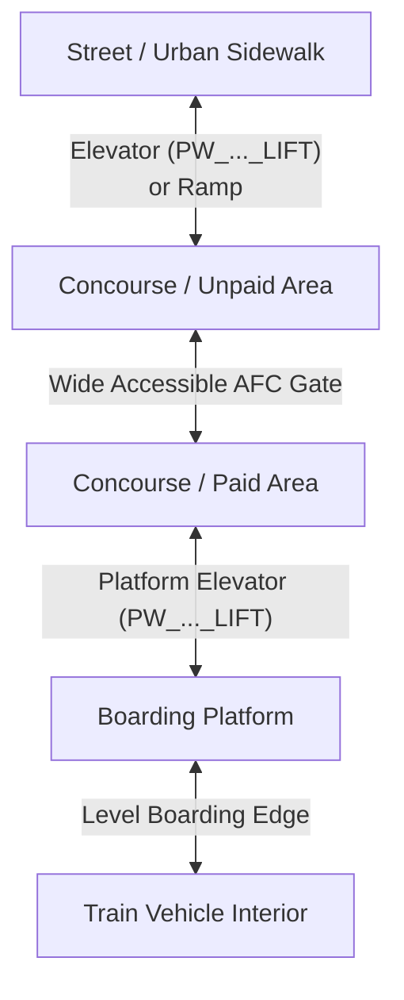

# TransitOS — Station Accessibility & Micro-Mobility

## The Accessibility Challenge in Indian Metros

Modern mass transit corridors in Indian metropolitan cities are heavily elevated or deep underground. While stations are nominally designed with barrier-free features under national guidelines, the real-world passenger experience frequently encounters friction:
* Unreliable or out-of-service street-to-concourse elevators.
* Multi-level interchange corridors lacking continuous step-free pathways.
* Station gates terminating onto narrow, obstructed sidewalks or un-signalized arterial roads.
* Inadequate digital information identifying *which specific gate* possesses a working street elevator.

TransitOS addresses this with a dedicated **Station Accessibility & Micro-Mobility Engine**.

---

## Multi-Level Accessibility Architecture

---

## Micro-Interchange Barrier Modeling

Inside the Canonical Transit Model (CTM), every element along the pedestrian path is tagged with accessibility metadata:

1. **`wheelchair_boarding`**:
   * `1`: Fully accessible (step-free path from street to platform, level boarding edge, tactile paving).
   * `2`: Inaccessible (requires stairs or lacks operational elevator).
   * `0`: Unknown or unverified accessibility.

2. **Step-Free Graph Traversal**:
   When a user requests a step-free journey, the pathfinding engine filters the in-station multigraph:
   * **Excluded**: All edges with `edge_type = 'STAIRS'` or `edge_type = 'ESCALATOR'`.
   * **Included**: Edges with `edge_type = 'ELEVATOR'`, `edge_type = 'RAMP'`, or level `CORRIDOR`.
   * **Queuing & Cycle Penalties**: Elevator wait and cycle times are explicitly modeled ($t_{\text{lift}} = 30\text{–}60\text{ s}$) rather than assuming zero-friction instantaneous vertical movement.

3. **Gate-Specific Accessibility**:
   Rather than labeling an entire station as simply "accessible" or "inaccessible", TransitOS provides granular gate-level status:
   * *Example*: At **Churchgate Metro (`STN_L3_025`)**, Gates A3, A5, and B1 provide direct street-to-concourse elevators, whereas Gates A1, A2, A4, and B2 provide stairs and escalators only. Commuters with mobility impairments are routed specifically through Gate A3 or B1.

---

## First/Last-Mile Pedestrian Catchments

Accessibility extends beyond the station envelope into the surrounding neighborhood:
* **True Sidewalk Isochrones**: TransitOS generates 5, 10, and 15-minute walking catchment polygons computed along walkable street vectors rather than crude Euclidean (as-the-crow-flies) circular buffers.
* **Physical Barrier Recognition**: High-speed highways without crosswalks, railway tracks, and water bodies are modeled as hard pedestrian barriers.
