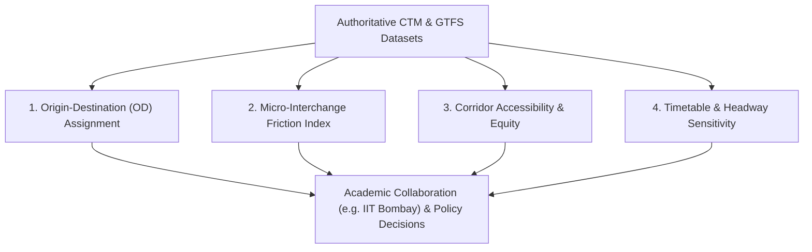

# TransitOS — Mobility Intelligence & Research Analytics

## Advanced Transport Modeling Capabilities

TransitOS is designed to serve as an analytical foundation for academic researchers, transport economists, and urban planning agencies.

By connecting timetable data, physical station geometry, and pedestrian networks within an authoritative relational schema, TransitOS enables analyses that go far beyond standard commuter trip planning.

---

## Analytical Modules

### 1. The Interchange Friction Index (IFI)
Standard transport models often treat transfers as a simple flat time penalty (e.g., $+5\text{ minutes}$). In reality, interchange friction is governed by the physical built environment.

TransitOS formalizes the **Interchange Friction Index (IFI)**:
$$\text{IFI} = \alpha \cdot t_{\text{walk}} + \beta \cdot \Delta Z_{\text{up}} + \gamma \cdot \Delta Z_{\text{down}} + \delta \cdot N_{\text{AFC}} + \epsilon \cdot t_{\text{wait}}$$

Where:
* $t_{\text{walk}}$: Pure horizontal walking time along FOBs or transfer tunnels.
* $\Delta Z_{\text{up}}, \Delta Z_{\text{down}}$: Cumulative vertical elevation shifts in meters.
* $N_{\text{AFC}}$: Number of ticket barrier turnstiles or security checkpoints encountered.
* $t_{\text{wait}}$: Expected headway wait time for the connecting service.
* $\alpha, \beta, \gamma, \delta, \epsilon$: Empirical commuter impedance coefficients.

*Research Application*: Quantifying how physical infrastructure improvements (such as installing moving travelators or eliminating redundant security screenings) reduce system-wide transfer impedance.

---

### 2. Corridor Sensitivity & Scenario Simulation
Planners can simulate operational network changes to measure commuter route diversion:
* **Headway Tuning**: Testing the effect of reducing peak headway on Line 3 from 4 minutes to 3 minutes on suburban rail parallel congestion.
* **Corridor Extensions**: Simulating the opening of Metro Line 2B or Line 4 and evaluating shifting transfer volumes at interchange hubs like Chembur, D.N. Nagar, and Ghatkopar.
* **Station Closure Resilience**: Modeling the travel time impact on commuters if a critical interchange node undergoes maintenance or temporary disruption.

---

### 3. Origin-Destination (OD) Flow Estimation & Assignment
* When combined with public footfall datasets or sample passenger surveys, TransitOS's multigraph routing engine can assign origin-destination trips across Pareto-optimal alternative paths.
* Calculates link load volumes, transfer hub crowding indicators, and passenger route choice probabilities using multinomial logit (MNL) discrete choice models.

---

## Academic Partnership Tracks (e.g., IIT Bombay)

TransitOS is positioned to collaborate with research bodies such as the **IIT Bombay Transportation Systems Engineering (TSE)** group through established institutional interaction pathways:
* **Joint Research Projects**: Applying TransitOS's ground-truthed spatial models to publish peer-reviewed papers on pedestrian transfer behavior in Indian megacities.
* **Open Datasets for Students & Scholars**: Supplying cleaned, validated GTFS and GeoJSON datasets for academic coursework, dissertations, and urban planning studios.
* **Reproducible Benchmarks**: Providing a public, version-controlled computational platform that other researchers can independently inspect, run, and verify.
