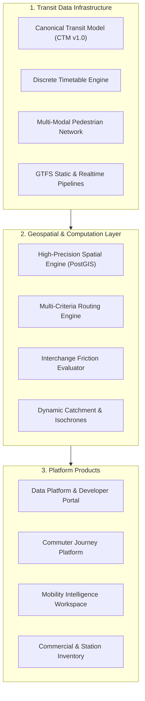

# TransitOS — Product Overview

## Executive Vision

**TransitOS** is an urban transit data infrastructure and mobility intelligence platform designed to transform fragmented public transit information into a unified, validated, and queryable digital representation of multi-modal transit networks.

In many rapidly expanding metropolitan areas, public transit data is heavily fragmented across multiple operating entities, proprietary CAD blueprints, static PDF timetables, and uncoordinated open-data portals. Stations are frequently represented merely as isolated 2D coordinate points, obscuring the physical reality of multi-level pedestrian concourses, fare barriers (AFC), vertical lifts and escalators, street-level gate access, and suburban rail interchange walkways.

TransitOS bridges this fundamental gap by establishing a **canonical data foundation** paired with high-precision geospatial services, micro-interchange modeling, versioned developer APIs, a passenger-facing application, and research-grade mobility analytics.

---

## Core Product Offerings

TransitOS organizes its software and data capabilities into three distinct products built upon a shared data foundation:

### 1. Transit Data Platform & Developer APIs
* **The Foundation**: Serves as the central data repository, curation pipeline, and distribution mechanism for transit networks across metropolitan regions.
* **Key Capabilities**:
  * Authoritative, validated **GTFS Schedule** feeds (with discrete run times, trip-level headways, and verified stop sequence).
  * Streaming **GTFS-Realtime (GTFS-RT)** feeds covering Trip Updates, Vehicle Positions, and Service Alerts.
  * Station entrance, level, platform, and micro-interchange walking graphs.
  * High-performance REST and WebSocket APIs enabling third-party developers, researchers, and transit agencies to query routes, station topologies, and live network states.

### 2. Commuter Journey Platform (MetroRadar)
* **The Passenger Experience**: A clean, accessible, modern web and mobile application that assists riders in planning realistic journeys across complex multi-modal transit networks.
* **Key Capabilities**:
  * Realistic departure-to-arrival itineraries factoring in walking times through foot overbridges (FOBs), ticket gates, stairs, lifts, and platforms.
  * Gate-specific navigation guiding commuters directly to the nearest street exit for their destination.
  * Real-time vehicle positions, arrival predictions, and live disruption alerts.
  * Digital twin station floor plans visualizing concourse layouts, amenities, and step-free access paths.

### 3. Mobility Intelligence & Research Workspace
* **The Analytical Engine**: A spatial analytics suite designed for transport planners, university researchers, and policy analysts.
* **Key Capabilities**:
  * **Station Catchment Analysis**: High-resolution 5, 10, and 15-minute pedestrian walking isochrones calculated along actual street networks and through station gates.
  * **Interchange Friction Assessment**: Empirical quantification of transfer impedance across physical barriers, vertical elevation shifts ($\Delta Z$), and fare boundaries.
  * **Network Resilience & Scenario Modeling**: Simulated sensitivity testing evaluating how corridor adjustments, headway changes, or line disruptions impact commuter travel impedance.

---

## Target Stakeholders & Use Cases

| Stakeholder Group | Primary Needs | TransitOS Solution |
| :--- | :--- | :--- |
| **Commuters & Passengers** | Reliable travel times, gate-level wayfinding, step-free access information, live train tracking. | MetroRadar web/mobile app with verified gate locations and realistic transfer walking times. |
| **App Developers & Startups** | Standardized, high-quality transit APIs and validated GTFS/GTFS-RT feeds for Mumbai, Pune, Nagpur, etc. | Versioned REST/GraphQL APIs, open dataset downloads, and interactive API documentation. |
| **Academic Researchers (e.g. IIT Bombay)** | Ground-truthed spatial datasets, reproducible graph models, origin-destination matrices, catchment analytics. | Open data exports, documented mathematical routing formulations, and reproducible simulation benchmarks. |
| **Transit Operators (MMRCL, MMMOCL, PMPML)** | Station footfall analytics, interchange congestion points, catchment overlap, data validation tooling. | Operational dashboards, GTFS conformance reports, and digital twin station layouts. |
| **Government & Public Mobility Bodies** | An interoperable, vendor-neutral urban transit data stack aligned with national open data standards. | A reusable, open architecture inspired by the Delhi Transport Stack, establishing unified transit data across Maharashtra. |
