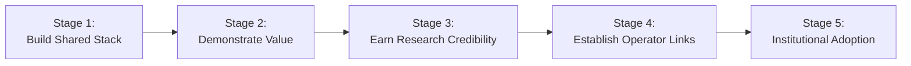
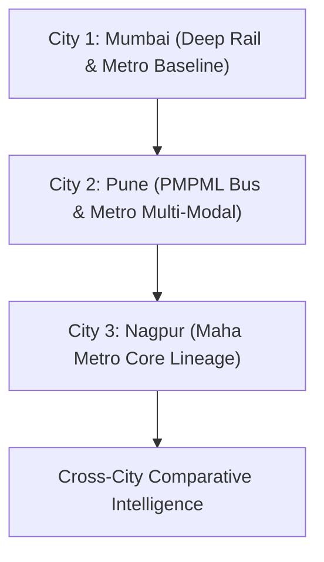

# TransitOS — Product & Growth Strategy

## Strategic Context: The Opportunity for an Open Transport Stack

Urban mobility platforms often fall into one of two extremes:
1. **Passenger-only mobile apps** that scrape basic schedules to display static arrival times, lacking deep geospatial infrastructure, station topology, or developer openness.
2. **Proprietary enterprise solutions** sold to single transit agencies that silo data, limit interoperability, and fail to provide open ecosystems for independent researchers and startups.

TransitOS takes a fundamentally different path: **build the underlying transit data infrastructure and intelligence stack first**, and demonstrate its power through passenger applications, open APIs, and academic research collaborations.

Two contemporary reference models illustrate this potential:
* **[Delhi Transport Stack](https://delhi.transportstack.in/)**: A comprehensive, government-backed public transit catalogue bringing together static transit schedules, bus telemetry, metro gates, fare structures, accessibility indicators, and passenger footfall under standard schemas.
* **[Chartr](https://www.chartr.in/)**: An integrated transit technology provider delivering digital ticketing, bus telemetry, operational dashboards, and passenger information systems across cities like Delhi and Pune.

TransitOS aims to deliver a modern, open-standards transit data platform adapted for Maharashtra (starting with Mumbai, followed by Pune and Nagpur), creating an interoperable bridge between transport authorities, academic institutions, developers, and citizens.

---

## The Five-Stage Strategic Roadmap

### Stage 1: Build the Robust Data Stack (Foundation)
* Construct a canonical spatial data model (CTM v1.0) linking routes, stations, platforms, levels, and street gates.
* Establish automated data validation pipelines ensuring 100% referential integrity and strict GTFS / GTFS-RT compliance.
* Synthesize discrete timetable schedules and detailed in-station pedestrian pathways.

### Stage 2: Demonstrate Tangible Value (Public Proof-of-Concept)
* Deploy the **MetroRadar** commuter platform showcasing door-to-door multi-modal routing, realistic transfer friction, and gate-level directions.
* Publish interactive Data Explorer and catchment isochrone visualizers to demonstrate actionable insights from connected spatial data.

### Stage 3: Earn Academic & Research Credibility
* Collaborate with premier academic institutions, notably **IIT Bombay (Transportation Systems Engineering, Civil Engineering Department, IRCC, SINE)**.
* Focus on solvable, concrete research questions:
  * Evaluating pedestrian transfer friction across major multi-modal hubs (e.g., D.N. Nagar/Andheri West, Gundavali/WEH, Dadar, Kurla).
  * High-resolution pedestrian accessibility and first/last-mile transit coverage.
* Provide researchers with reproducible datasets, methodology whitepapers, and verifiable ground-truth benchmarks.

### Stage 4: Establish Transit Operator Relationships
* Engage with local operators (MMRCL, MMMOCL, Maha Metro, PMPML) to provide feedback on schedule modeling, gate naming discrepancies, and digital twin layouts.
* Share data validation reports, GTFS health audits, and station accessibility findings that help operators improve service delivery.

### Stage 5: Pursue Formal Institutional & Government Adoption
* Align with national transport innovation initiatives such as the **Atal New India Challenge (AIM)** and state open-data programs.
* Position TransitOS as a trusted open-source transport stack for metropolitan regions, enabling standardized multi-agency mobility ecosystems.

---

## Multi-City Phased Rollout

Rather than attempting to ingest every dataset across multiple cities at once, TransitOS follows a disciplined, repeatable operational playbook:

1. **Mumbai (Active Baseline)**:
   * Metro Lines 1, 2A, 2B, 3, 7, 9, and Mumbai Monorail.
   * Full micro-interchange walking models and physical FOB linkages with Western and Central Railway suburban platforms.
   * Comprehensive discrete timetable schedules and verified street entrance coordinates.
2. **Pune (Phase 2)**:
   * Pune Metro (Purple Line & Aqua Line).
   * Evaluate PMPML bus network data integration and bus-to-metro transfer nodes.
   * Reuse the canonical ingestion, validation, and isochrone pipelines without software re-architecture.
3. **Nagpur (Phase 3)**:
   * Nagpur Metro (Orange Line & Aqua Line).
   * Ingest published Maha Metro GTFS and GIS alignments, verifying station access points and feeder catchments.
4. **Cross-City Mobility Intelligence (Phase 4)**:
   * Benchmark network accessibility, transfer efficiency, speed profiles, and coverage equity across Mumbai, Pune, and Nagpur.
